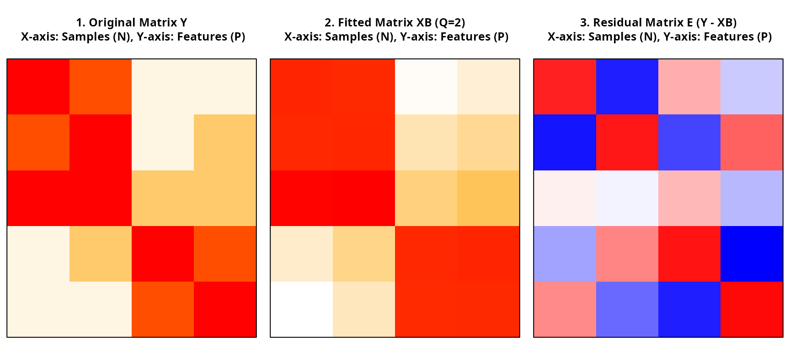

# Introduction to nmfkc

## Introduction

Welcome to the `nmfkc` package! This vignette provides a
beginner-friendly introduction to the core function,
[`nmfkc()`](https://ksatohds.github.io/nmfkc/reference/nmfkc.md).

**Non-negative Matrix Factorization (NMF)** is a technique that
decomposes a large data matrix \\Y\\ into two smaller matrices, \\X\\
and \\B\\: \\Y \approx X B\\ The key feature of NMF is that all elements
must be **non-negative** (\\\ge 0\\). This makes the results intuitive,
as the original data can be understood as an additive combination of
parts.

In this guide, we will cover:

1.  **Basic NMF**: Extracting latent topics using a Movie Ratings
    example.
2.  **Interpretation**: Understanding what the decomposed matrices
    represent.
3.  **Missing Values**: How to handle and predict missing data (e.g.,
    for recommendations).

------------------------------------------------------------------------

## 1. Basic Usage: Analyzing Movie Ratings

To understand NMF, let’s imagine a scenario with **5 Users** rating **4
Movies** on a scale of 1 to 5.

First, load the package.

``` r
library(nmfkc)
```

### Creating the Data

We create a rating matrix `Y`. The dataset contains two hidden genres:
“Action” (Movies 1 & 2) and “Romance” (Movies 3 & 4).

``` r
# Rows: Users (U1-U5), Cols: Movies (M1-M4)
# U1, U2, U3 prefer Action movies.
# U4, U5 prefer Romance movies.
Y <- matrix(
  c(5, 4, 1, 1,
    4, 5, 1, 2,
    5, 5, 2, 2,
    1, 2, 5, 4,
    1, 1, 4, 5),
  nrow = 5, byrow = TRUE
)

# Assign names for better interpretation
rownames(Y) <- paste0("User", 1:5)
colnames(Y) <- c("Action1", "Action2", "Romance1", "Romance2")

# Check the data
print(Y)
#>       Action1 Action2 Romance1 Romance2
#> User1       5       4        1        1
#> User2       4       5        1        2
#> User3       5       5        2        2
#> User4       1       2        5        4
#> User5       1       1        4        5
```

### Running NMF

We use the
[`nmfkc()`](https://ksatohds.github.io/nmfkc/reference/nmfkc.md)
function to decompose this matrix. Since we assume there are 2 genres
(Action and Romance), we set **rank = 2**.

``` r
# Run NMF with rank = 2
res <- nmfkc(Y, rank = 2, seed = 123)
#> Y(5,4)~X(5,2)B(2,4)...0sec
```

### Interpretation

NMF decomposes \\Y\\ into \\X\\ (Basis) and \\B\\ (Coefficient). *(Note:
The order of bases may vary depending on the random seed. In this
example with seed=123, Basis 1 corresponds to Action and Basis 2 to
Romance.)*

#### 1. Basis Matrix X: User Preferences

The matrix \\X\\ represents **“How much each User likes each Genre
(Basis).”**

``` r
# Each column represents a latent factor (Basis)
res$X
#>            Basis1     Basis2
#> User1 0.313397420 0.03671376
#> User2 0.304765794 0.08552167
#> User3 0.333724154 0.12109379
#> User4 0.039553910 0.37804885
#> User5 0.008558722 0.37862193
```

- **Basis1**: High values for **User1, User2, and User3** (Action fans).
- **Basis2**: High values for **User4 and User5** (Romance fans).

#### 2. Coefficient Matrix B: Movie Genres

The matrix \\B\\ represents **“Which Genre each Movie belongs to.”**

``` r
# Each row represents a latent factor
res$B
#>          Action1   Action2  Romance1  Romance2
#> Basis1 14.275611 13.907355  1.264821  2.166817
#> Basis2  1.672713  3.159933 11.781222 11.778951
```

- **Basis1**: High weights on **Action1 and Action2**.
- **Basis2**: High weights on **Romance1 and Romance2**.

As you can see, NMF automatically discovered the hidden structures
(“Action” vs “Romance”) and user preferences without being explicitly
told.

------------------------------------------------------------------------

## 2. Visualization

`nmfkc` provides tools to visually diagnose your model.

### Convergence Plot

Use the [`plot()`](https://rdrr.io/r/graphics/plot.default.html)
function to check if the error minimized properly during iterations.

``` r
plot(res, main = "Convergence Plot")
```


### Visualizing the Reconstruction

The
[`nmfkc.residual.plot()`](https://ksatohds.github.io/nmfkc/reference/nmfkc.residual.plot.md)
function allows you to compare the **Original Matrix (\\Y\\)**, the
**Fitted Matrix (\\XB\\)**, and the **Residuals (\\E\\)** side-by-side.

``` r
# Visualize Original vs Fitted vs Residuals
nmfkc.residual.plot(Y, res)
```



The middle plot (Fitted Matrix) successfully captures the block
structure of the original data.

------------------------------------------------------------------------

## 3. Handling Missing Values (Imputation)

A powerful feature of `nmfkc` is its robustness to **Missing Values
(`NA`)**. This is useful for tasks like **Recommendation Systems**,
where you want to predict how a user would rate a movie they haven’t
seen yet.

### Creating Data with Missing Values

Let’s assume **User1** has not seen **Action1** yet. We set this value
to `NA`.

``` r
Y_missing <- Y
Y_missing["User1", "Action1"] <- NA # Introduce missing value
print(Y_missing)
#>       Action1 Action2 Romance1 Romance2
#> User1      NA       4        1        1
#> User2       4       5        1        2
#> User3       5       5        2        2
#> User4       1       2        5        4
#> User5       1       1        4        5
```

### Running NMF with NAs

Simply pass the matrix with `NA`s to
[`nmfkc()`](https://ksatohds.github.io/nmfkc/reference/nmfkc.md). The
algorithm automatically handles them by ignoring the missing entries
during optimization.

``` r
res_na <- nmfkc(Y_missing, rank = 2, seed = 123)
#> Notice: Missing values (NA) in Y were treated as weights=0.
#> Y(5,4)~X(5,2)B(2,4)...0sec
```

### Predicting the Unknown Rating

The fitted model (\\X \times B\\) provides an estimate for the missing
entry.

``` r
# Extract the predicted value from the fitted matrix XB
predicted_rating <- res_na$XB["User1", "Action1"]
actual_rating <- Y["User1", "Action1"] # The original hidden value (5)

cat(paste0("Actual Rating:    ", actual_rating, "\n"))
#> Actual Rating:    5
cat(paste0("Predicted Rating: ", round(predicted_rating, 2), "\n"))
#> Predicted Rating: 3.62
```

Because User1 liked other Action movies, the model predicted a
**reasonably high rating (3.62)** for the missing Action movie, closer
to the actual rating (5) than to a low rating.

## Summary

With the `nmfkc` package, you can easily:

1.  **Decompose** complex data into interpretable parts (\\X\\ and
    \\B\\).
2.  **Handle missing values** robustly for imputation and prediction.
3.  **Visualize** the results to verify the fit.

For more advanced topics, such as Time Series Analysis or
Covariate-assisted NMF, please refer to the other vignettes
(`Topic Modeling` and `Time Series Analysis`).
