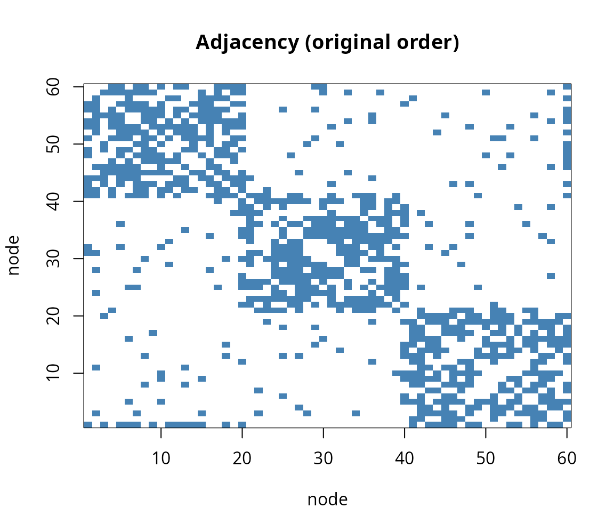
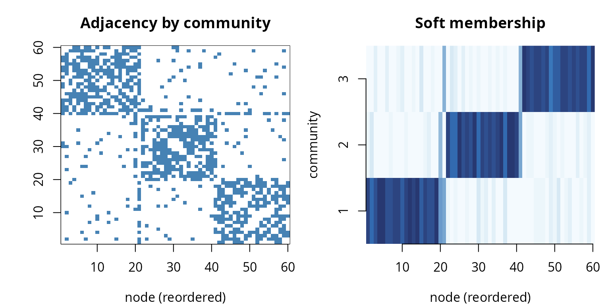
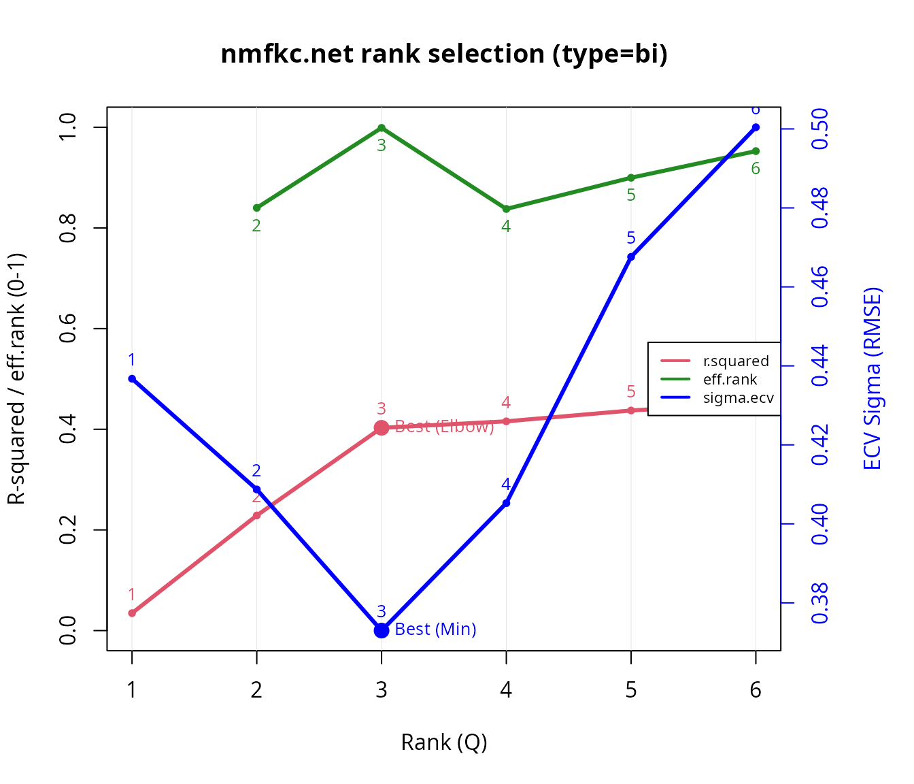

# Soft community detection in networks with nmfkc.net

## Introduction

[`nmfkc.net()`](https://ksatohds.github.io/nmfkc/reference/nmfkc.net.md)
is a **symmetric** NMF for network (adjacency) matrices. With
`type = "bi"` it factorises a symmetric matrix as with . Each row of is
a node’s **graded membership** across communities, so this is *soft*
community detection: unlike a hard method (e.g. Louvain), boundary nodes
are revealed by a mixed membership rather than being forced into one
group.

This vignette uses a **self-contained synthetic network with a known
community structure**, so we can check that
[`nmfkc.net()`](https://ksatohds.github.io/nmfkc/reference/nmfkc.net.md)
recovers it and that
[`nmfkc.net.rank()`](https://ksatohds.github.io/nmfkc/reference/nmfkc.net.rank.md)
finds the right number of communities.

``` r
library(nmfkc)
```

## A synthetic network (stochastic block model, 3 communities)

We draw an undirected graph on `60` nodes from a **stochastic block
model**: three communities of 20 nodes, with a high within-community
edge probability and a low between-community one. We then deliberately
add **three “bridge” nodes** (one per community), each also wired to a
*second* community, so that the network contains a few genuinely mixed
nodes. The true community of each node is known.

``` r
set.seed(1)
K <- 3; n_each <- 20; N <- K * n_each       # 60 nodes, 3 communities
block <- rep(1:K, each = n_each)            # true community labels

p_in <- 0.6; p_out <- 0.05
Prob <- matrix(p_out, N, N)
for (k in 1:K) Prob[block == k, block == k] <- p_in
Y <- matrix(rbinom(N * N, 1, Prob), N, N)   # 0/1 adjacency
Y[lower.tri(Y)] <- t(Y)[lower.tri(Y)]        # make symmetric
diag(Y) <- 0

# add three bridge nodes, each also linked to a second community
bridge <- c(20, 40, 60); into <- c(2, 3, 1)
for (i in seq_along(bridge)) {
  b <- bridge[i]; tgt <- which(block == into[i])
  e <- rbinom(length(tgt), 1, 0.45)
  Y[b, tgt] <- pmax(Y[b, tgt], e); Y[tgt, b] <- Y[b, tgt]
}

isSymmetric(Y); sum(Y) / 2                   # symmetric, number of edges
#> [1] TRUE
#> [1] 437

# adjacency matrix in the original (random) node order -- structure is hidden
image(1:N, 1:N, Y[, N:1], col = c("white", "steelblue"),
      xlab = "node", ylab = "node", main = "Adjacency (original order)")
```



## Soft community detection with `nmfkc.net`

``` r
res <- nmfkc.net(Y, rank = 3, type = "bi", nstart = 10, maxit = 500)
res$r.squared                 # fit
#> [1] 0.4028952
head(round(res$X.prob, 2))    # soft membership: rows = nodes, columns = communities
#>      Basis1 Basis2 Basis3
#> [1,]   0.92   0.08   0.00
#> [2,]   0.80   0.16   0.04
#> [3,]   0.88   0.00   0.12
#> [4,]   0.96   0.04   0.00
#> [5,]   0.96   0.04   0.00
#> [6,]   0.86   0.02   0.12
head(res$X.cluster)           # hard label = argmax membership
#> [1] 1 1 1 1 1 1
```

## Did it recover the known communities?

``` r
table(true = block, estimated = res$X.cluster)
#>     estimated
#> true  1  2  3
#>    1 20  0  0
#>    2  0 20  0
#>    3  1  0 19

# the three bridge nodes have genuinely split memberships
round(res$X.prob[bridge, ] * 100, 1)
#>      Basis1 Basis2 Basis3
#> [1,]   57.4   41.4    1.1
#> [2,]    0.7   53.4   45.9
#> [3,]   51.1    0.0   48.9
```

The cross-tabulation is essentially block-diagonal: apart from the
bridge nodes, every node is assigned to its true community. The bridge
nodes (rows above) are roughly **50/50 between two communities**, so
their hard label simply tips to whichever side is marginally stronger —
exactly the situation where a *soft* membership is more informative than
a forced assignment.

## Visualising the result

Re-ordering the nodes by the **recovered** community turns the adjacency
matrix into a clean block-diagonal, and the membership matrix shows
three crisp blocks:

``` r
ord <- order(res$X.cluster)
op <- par(mfrow = c(1, 2), mar = c(4, 4, 3, 1))
image(1:N, 1:N, Y[ord, rev(ord)], col = c("white", "steelblue"),
      xlab = "node (reordered)", ylab = "", main = "Adjacency by community")
image(1:N, 1:K, res$X.prob[ord, , drop = FALSE],
      col = hcl.colors(20, "Blues", rev = TRUE),
      xlab = "node (reordered)", ylab = "community", axes = FALSE,
      main = "Soft membership")
axis(1); axis(2, at = 1:K)
```



``` r
par(op)
```

## Network diagram (Graphviz DOT): soft vs. hard

[`nmfkc.net.DOT()`](https://ksatohds.github.io/nmfkc/reference/nmfkc.net.DOT.md)
turns the fit into a Graphviz **DOT** graph: each network node is linked
to the community (basis) hubs by edges whose thickness encodes the
membership strength. We raise `threshold` to `0.25` so that only
substantial memberships are drawn — each pure node then links to a
*single* hub, which lets the `neato` layout pull the three communities
apart, while the bridge nodes keep *both* links and settle in between.
Rendered with the suggested package **DiagrammeR**, it embeds directly
in the HTML output. The only difference between the two views below is
the **node colour**:

- `Y.cluster = "soft"` (default) blends the community colours in
  proportion to the membership, so the three bridge nodes appear in a
  **mixed colour**.
- `Y.cluster = "hard"` paints each node in the **single colour** of its
  dominant community.

**Soft** – the three bridge nodes added earlier
(`bridge <- c(20, 40, 60)`, each wired to a second community) show a
blended colour:

``` r
dot_soft <- nmfkc.net.DOT(res,
  Y.label = as.character(1:N), X.label = paste("Community", 1:K),
  Y.title = "Network nodes",   X.title = "Communities",
  layout  = "neato", threshold = 0.25, Y.cluster = "soft")
DiagrammeR::grViz(as.character(dot_soft))
```

**Hard** – those same bridge nodes (20, 40, 60) are forced into one
community colour:

``` r
dot_hard <- nmfkc.net.DOT(res,
  Y.label = as.character(1:N), X.label = paste("Community", 1:K),
  Y.title = "Network nodes",   X.title = "Communities",
  layout  = "neato", threshold = 0.25, Y.cluster = "hard")
DiagrammeR::grViz(as.character(dot_hard))
```

(If DiagrammeR is not installed, both diagrams are skipped.)

## How many communities? `nmfkc.net.rank`

The same rank-selection diagnostics as `nmfkc.rank` are available for
the symmetric model. The recommended rank is the cross-validation (ECV)
minimum; the effective rank and R-squared elbow corroborate it.

``` r
rk <- nmfkc.net.rank(Y, rank = 1:6, type = "bi", nstart = 5)
#> Note: sample-clustering quality (silhouette / CPCC / dist.cor) is not part of rank selection; compute it from a list of fits with nmf.cluster.criteria().  See ?nmf.cluster.criteria
```



``` r
rk$rank.best
#> [1] 3
round(rk$criteria, 3)
#>   rank effective.rank effective.rank.ratio r.squared sigma.ecv
#> 1    1             NA                   NA     0.035     0.437
#> 2    2          1.944                0.972     0.229     0.409
#> 3    3          2.999                1.000     0.403     0.373
#> 4    4          3.830                0.958     0.416     0.405
#> 5    5          4.860                0.972     0.437     0.468
#> 6    6          5.918                0.986     0.452     0.500
#>   effective.rank.expected effective.rank.index
#> 1                   1.000                   NA
#> 2                   1.649                0.840
#> 3                   2.301                0.999
#> 4                   2.955                0.838
#> 5                   3.609                0.900
#> 6                   4.263                0.953
```

## Remarks

[`nmfkc.net()`](https://ksatohds.github.io/nmfkc/reference/nmfkc.net.md)
recovers the three planted communities for the core nodes, and
[`nmfkc.net.rank()`](https://ksatohds.github.io/nmfkc/reference/nmfkc.net.rank.md)
selects three. Because the membership is *soft* (`res$X.prob`), the
three bridge nodes that sit between communities show a split membership
instead of being forced into one group — the practical advantage of NMF
over hard community detection, made visible by the soft-vs-hard DOT
graphs above.

`type = "bi"` () is the usual choice for an undirected, non-negative
network; `type = "tri"` () adds a community-interaction matrix , and
`type = "signed"` handles networks with negative weights. For choosing
the number of communities, the same advice as in the *rank-selection*
vignette applies: use the ECV minimum as the primary criterion and
corroborate it with the effective rank.

See
[`?nmfkc.net`](https://ksatohds.github.io/nmfkc/reference/nmfkc.net.md),
[`?nmfkc.net.ecv`](https://ksatohds.github.io/nmfkc/reference/nmfkc.net.ecv.md),
[`?nmfkc.net.rank`](https://ksatohds.github.io/nmfkc/reference/nmfkc.net.rank.md),
and the companion vignette *“Choosing the NMF rank on data with a known
true rank”*.
