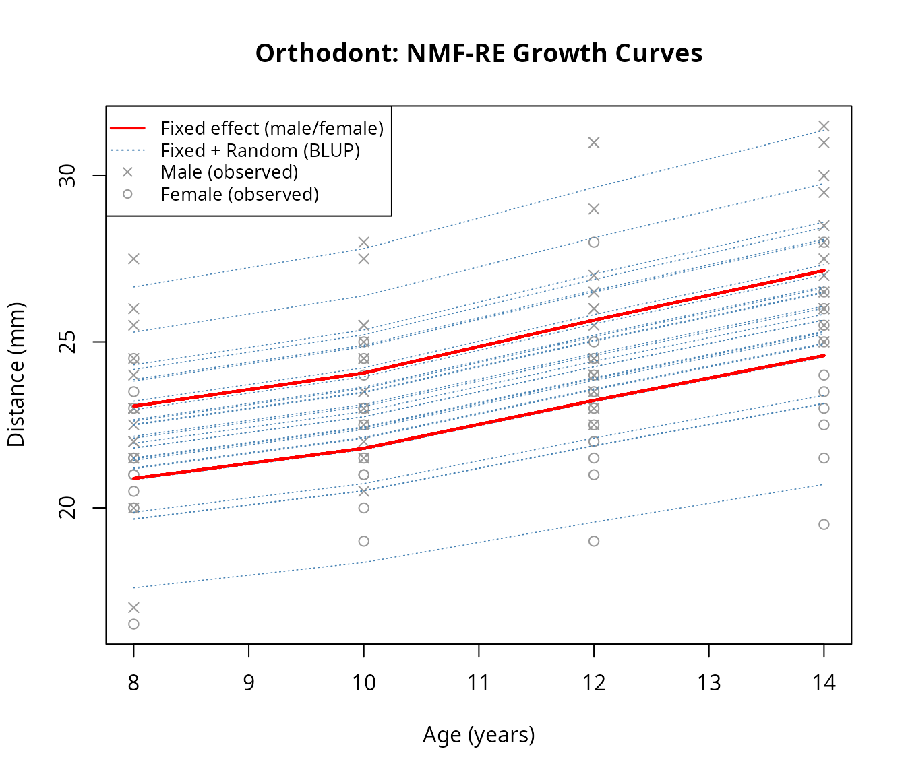
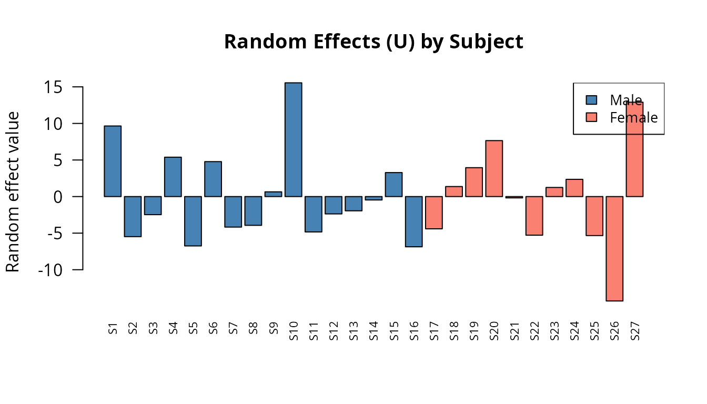
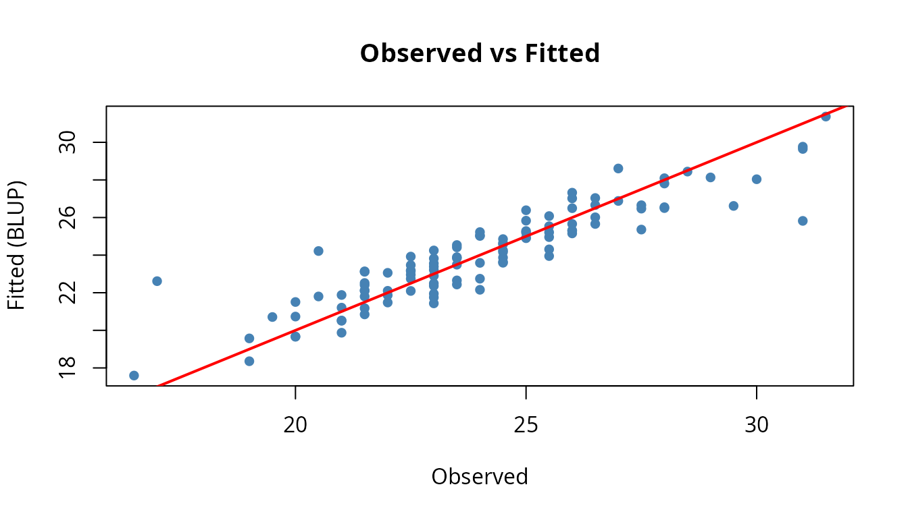

# NMF-RE: Mixed-Effects Modeling with nmfkc

## Introduction

This vignette demonstrates **NMF-RE** (Non-negative Matrix Factorization
with Random Effects), a mixed-effects extension of NMF implemented in
the `nmfkc` package.

### Why Mixed Effects?

Standard NMF with covariates models the data as: \\Y \approx X \Theta
A\\

where \\\Theta A\\ captures systematic (fixed) effects of covariates
\\A\\ on latent scores. However, in many applications — such as
longitudinal studies, panel data, or clustered observations —
individuals exhibit **unit-specific deviations** that cannot be
explained by covariates alone.

NMF-RE addresses this by adding **random effects** \\U\\: \\Y = X(\Theta
A + U) + \mathcal{E}\\

- \\Y\\ (\\P \times N\\): Non-negative observation matrix (e.g.,
  repeated measurements over \\P\\ time points for \\N\\ subjects).
- \\X\\ (\\P \times Q\\): Non-negative basis matrix learned from data.
- \\\Theta\\ (\\Q \times K\\): Coefficient matrix for covariate effects
  (denoted `C` in the package output).
- \\A\\ (\\K \times N\\): Covariate matrix (e.g., intercept, sex,
  treatment).
- \\U\\ (\\Q \times N\\): Random effects matrix capturing individual
  deviations.
- \\\mathcal{E}\\: Residual noise with variance \\\sigma^2\\.

The random effects follow \\\mathrm{Var}(\mathrm{vec}(U)) = \tau^2 I\\,
and the penalty \\\lambda = \sigma^2 / \tau^2\\ determines the degree of
shrinkage. The marginal model is \\\boldsymbol y_n \sim
N\\\big(X\Theta\boldsymbol a_n,\\ \tau^2 X X^\top + \sigma^2 I\big).\\

### Key Features

- **EM/ECM estimation**: An outer–inner ECM algorithm alternates a
  ridge/BLUP step for \\U\\, a semi-NMF step for the basis \\X\\, and a
  fixed-effect update for \\\Theta\\ (inner loop, fixed \\\lambda\\),
  with EM M-steps for \\(\sigma^2, \tau^2)\\ (outer loop). The variance
  components are **estimated from the data** — there is no tuning
  parameter to set.
- **Sign-free or non-negative coefficients** via `C.signed` (see below).
- **Wild bootstrap inference**: Standard errors, z-values, p-values, and
  confidence intervals for \\\Theta\\ without repeated constrained
  re-optimization.
- **Trace-based ICC**: Quantifies the proportion of variance
  attributable to random effects.

### Sign convention: `C.signed`

The single argument `C.signed` selects the whole estimation scheme:

- **`C.signed = TRUE`** (default, recommended): the coefficients
  \\\Theta\\ are treated as **real-valued** (sign-free), updated by
  exact least squares. Inference uses a **two-sided** test (interior
  null \\H_0: \Theta\_{qk} = 0\\). This is the natural choice when
  covariate effects can be positive *or* negative.
- **`C.signed = FALSE`**: \\\Theta\\ is constrained to be
  **non-negative**, updated by a multiplicative update, with a
  **one-sided** test (boundary null \\H_0: \Theta\_{qk} = 0\\ vs \\H_1:
  \Theta\_{qk} \> 0\\). Use this for compositional or intensity-type
  scores.

In both cases the basis \\X\\ is always non-negative.

------------------------------------------------------------------------

## 1. Data: Orthodont (Longitudinal Growth)

We use the `Orthodont` dataset from the `nlme` package: orthodontic
distance measurements for 27 children at ages 8, 10, 12, and 14. The
covariate of interest is sex (Male/Female).

``` r
library(nmfkc)
library(nlme)

data(Orthodont, package = "nlme")
head(Orthodont)
#> Grouped Data: distance ~ age | Subject
#>   distance age Subject  Sex
#> 1     26.0   8     M01 Male
#> 2     25.0  10     M01 Male
#> 3     29.0  12     M01 Male
#> 4     31.0  14     M01 Male
#> 5     21.5   8     M02 Male
#> 6     22.5  10     M02 Male
```

### 1.1 Prepare the Observation Matrix Y

Each column of \\Y\\ is a subject, each row is a time point (age). Since
there are 4 ages and 27 subjects, \\Y\\ is \\4 \times 27\\.

``` r
Y <- matrix(Orthodont$distance, nrow = 4, ncol = 27)
colnames(Y) <- paste0("S", 1:27)
rownames(Y) <- paste("Age", c(8, 10, 12, 14))
Y[, 1:6]
#>        S1   S2   S3   S4   S5   S6
#> Age 8  26 21.5 23.0 25.5 20.0 24.5
#> Age 10 25 22.5 22.5 27.5 23.5 25.5
#> Age 12 29 23.0 24.0 26.5 22.5 27.0
#> Age 14 31 26.5 27.5 27.0 26.0 28.5
```

### 1.2 Prepare the Covariate Matrix A

We create a \\2 \times 27\\ covariate matrix with an intercept row and a
binary `male` indicator.

``` r
male <- ifelse(Orthodont$Sex[seq(1, 108, 4)] == "Male", 1, 0)
A <- rbind(intercept = 1, male = male)
A[, 1:6]
#>           [,1] [,2] [,3] [,4] [,5] [,6]
#> intercept    1    1    1    1    1    1
#> male         1    1    1    1    1    1
```

------------------------------------------------------------------------

## 2. Fitting the NMF-RE Model

We fit the model with `rank = 1` (a single latent growth trend). No
tuning parameter is required: the variance components \\(\sigma^2,
\tau^2)\\, and hence the penalty \\\lambda\\, are estimated by the
EM/ECM algorithm. We keep the default `C.signed = TRUE`, since the male
effect on growth could in principle have either sign. The `prefix`
argument labels the basis.

``` r
res <- nmfre(Y, A, rank = 1, prefix = "Trend")
```

### 2.1 Model Summary (fit)

[`nmfre()`](https://ksatohds.github.io/nmfkc/reference/nmfre.md)
performs **optimization only**.
[`summary()`](https://rdrr.io/r/base/summary.html) on a freshly fitted
object shows the variance components, fit statistics, and the
\\\mathrm{df}\_U\\ diagnostic; standard errors and p-values for
\\\Theta\\ are added in a separate inference step (Section 2.2),
mirroring the
[`nmfkc()`](https://ksatohds.github.io/nmfkc/reference/nmfkc.md) /
[`nmfkc.inference()`](https://ksatohds.github.io/nmfkc/reference/nmfkc.inference.md)
split.

``` r
summary(res)
#> NMF-RE: Y(4,27) = X(4,1) [C(1,2) A + U(1,27)]
#> Iterations: 41 / 5000 (converged)  epsilon = 1e-05  outer 20 / 500
#> R-squared (cor^2):    0.8246 (XB+blup), 0.4167 (XB)
#> R-squared (uncentered):     0.9974 (XB+blup), 0.9915 (XB)
#> R-squared (centered): 0.7594 (XB+blup), 0.2134 (XB)
#> 
#> Variance components:
#>   sigma2 = 1.933  (residual)
#>   tau2   = 48.19  (random effect)
#>   lambda = 0.04011  (sigma2 / tau2)
#>   ICC    = 0.6100  (tau2*tr(X'X) / (tau2*tr(X'X) + sigma2*P))
#>   dfU    = 23.28
#> 
#> Coefficients (Theta): run nmfre.inference(fit, Y, A) for SE / p-values.
```

**Variance components:**

- \\\sigma^2\\: Residual variance (measurement noise).
- \\\tau^2\\: Random effect variance (individual heterogeneity).
- \\\lambda = \sigma^2/\tau^2\\: The shrinkage penalty on \\U\\, derived
  from the estimated variances.
- **ICC**: Proportion of variance from random effects. Higher ICC means
  stronger individual differences relative to noise.
- \\\mathrm{df}\_U\\: The effective degrees of freedom consumed by the
  random effects, reported purely as a **complexity diagnostic** (the
  saturation ratio \\\mathrm{df}\_U/(NQ)\\ is shown by `res$dfU.frac`).
  No cap is imposed.

``` r
cat("sigma^2 =", round(res$sigma2, 4), "\n")
#> sigma^2 = 1.9328
cat("tau^2   =", round(res$tau2, 4), "\n")
#> tau^2   = 48.1908
cat("lambda  =", round(res$lambda, 5), "\n")
#> lambda  = 0.04011
cat("dfU     =", round(res$dfU, 2),
    "  dfU/(NQ) =", round(res$dfU.frac, 4), "\n")
#> dfU     = 23.28   dfU/(NQ) = 0.8622
```

**R-squared:**

- \\R^2\\ (XB+blup): Fit including both fixed and random effects.
- \\R^2\\ (XB): Fit from fixed effects only — the gap shows how much the
  random effects improve the fit.

### 2.2 Inference on \\\Theta\\ with `nmfre.inference()`

To obtain standard errors, z-values, p-values, and confidence intervals
for \\\Theta\\, pass the fit to
[`nmfre.inference()`](https://ksatohds.github.io/nmfkc/reference/nmfre.inference.md)
(sandwich SE + wild bootstrap, conditional on the estimated \\\hat X,
\hat U\\). It returns the same object with the inference fields added,
so [`summary()`](https://rdrr.io/r/base/summary.html) now prints the
coefficient table.

``` r
res <- nmfre.inference(res, Y, A, wild.B = 1000)
summary(res)
#> NMF-RE: Y(4,27) = X(4,1) [C(1,2) A + U(1,27)]
#> Iterations: 41 / 5000 (converged)  epsilon = 1e-05  outer 20 / 500
#> R-squared (cor^2):    0.8246 (XB+blup), 0.4167 (XB)
#> R-squared (uncentered):     0.9974 (XB+blup), 0.9915 (XB)
#> R-squared (centered): 0.7594 (XB+blup), 0.2134 (XB)
#> 
#> Variance components:
#>   sigma2 = 1.933  (residual)
#>   tau2   = 48.19  (random effect)
#>   lambda = 0.04011  (sigma2 / tau2)
#>   ICC    = 0.6100  (tau2*tr(X'X) / (tau2*tr(X'X) + sigma2*P))
#>   dfU    = 23.28
#> 
#> Coefficients:
#>                   Estimate Std. Error (Boot) z value Pr(>|z|) 
#> intercept:Trend1    90.506      2.472  2.524   36.62   <2e-16 ***
#>      male:Trend1     9.423      3.057  3.070    3.08 0.002052 **
#> ---
#> Signif. codes:  0 '***' 0.001 '**' 0.01 '*' 0.05 '.' 0.1 ' ' 1
#> C (= Theta) update: sign-free (real-valued); p-values two.sided
```

**Coefficient table (\\\Theta\\):**

- **Estimate**: Effect of each covariate on the latent trend.
- **Std. Error**: Analytic (sandwich) standard error; the **(Boot)**
  column is the wild-bootstrap standard error.
- **Pr(\>\|z\|)**: With the default `C.signed = TRUE`, this is a
  **two-sided** p-value (\\H_0: \Theta\_{qk} = 0\\). Both the intercept
  and the male effect are detected as statistically significant.

The sidedness follows the fit: sign-free \\\Theta\\ (`C.signed = TRUE`)
uses a two-sided test, while the non-negative variant
(`C.signed = FALSE`) uses a one-sided (boundary) test.

------------------------------------------------------------------------

## 3. Visualization

We plot the growth curves to see how the model captures both
population-level trends (fixed effects) and individual deviations
(random effects).

``` r
age <- c(8, 10, 12, 14)

plot(age, res$XB[, 1], type = "n", ylim = range(Y),
     xlab = "Age (years)", ylab = "Distance (mm)",
     main = "Orthodont: NMF-RE Growth Curves")

# Plot observed data points
for (j in 1:27) {
  pch_j <- ifelse(male[j] == 1, 4, 1)
  points(age, Y[, j], pch = pch_j, col = "gray60")
}

# Plot individual predictions (fixed + random effects)
for (j in 1:27) {
  lines(age, res$XB.blup[, j], col = "steelblue", lty = 3, lwd = 0.8)
}

# Plot population-level fixed effects (two lines: male and female)
for (j in 1:27) {
  lines(age, res$XB[, j], col = "red", lwd = 2)
}

legend("topleft",
  legend = c("Fixed effect (male/female)", "Fixed + Random (BLUP)",
             "Male (observed)", "Female (observed)"),
  lwd = c(2, 1, NA, NA), lty = c(1, 3, NA, NA),
  pch = c(NA, NA, 4, 1),
  col = c("red", "steelblue", "gray60", "gray60"),
  cex = 0.85)
```



### Interpreting the Plot

- **Red solid lines**: Population-level fitted values from fixed effects
  (\\X \Theta A\\). There are two distinct curves — one for males
  (higher) and one for females (lower) — reflecting the sex effect in
  \\\Theta\\.
- **Blue dashed lines**: Individual-level predictions (\\X(\Theta A +
  U)\\). Each line is shifted from the population curve by the subject’s
  random effect \\U\\, capturing personal growth trajectories.
- **Gray points**: Observed measurements. Crosses (\\\times\\) for
  males, circles (\\\circ\\) for females.

------------------------------------------------------------------------

## 4. Examining Learned Components

### 4.1 Basis Matrix X

The basis \\X\\ represents the latent temporal pattern shared across all
subjects.

``` r
cat("Basis X (temporal pattern):\n")
#> Basis X (temporal pattern):
print(round(res$X, 4))
#>        Trend1
#> Age 8  0.2308
#> Age 10 0.2408
#> Age 12 0.2567
#> Age 14 0.2717
```

Since `rank = 1`, there is one basis vector. Its shape shows how the
latent factor manifests across the four ages. The column is normalized
to sum to 1.

### 4.2 Coefficient Matrix \\\Theta\\

\\\Theta\\ (the `C` element) maps covariates to latent scores:

``` r
cat("Coefficient matrix (Theta):\n")
#> Coefficient matrix (Theta):
print(round(res$C, 4))
#>        intercept   male
#> Trend1   90.5058 9.4227
```

- `intercept`: Baseline level of the latent trend for females.
- `male`: Additional contribution for males. A significant value
  indicates that males have higher orthodontic distances on average.

### 4.3 Random Effects U

\\U\\ captures individual deviations. Subjects with positive \\U\\
values grow faster than the population average; negative values indicate
slower growth.

At convergence the random effects satisfy the identification condition
\\U A^\top = 0\\: they are orthogonal to the covariate rows, so \\U\\
contains exactly the individual variation that the covariates cannot
explain. (When \\A\\ includes an intercept row, as here, this implies
the familiar sum-to-zero centering of each row of \\U\\ across
subjects.)

``` r
barplot(res$U[1, ], names.arg = colnames(Y),
        las = 2, cex.names = 0.7,
        col = ifelse(male == 1, "steelblue", "salmon"),
        main = "Random Effects (U) by Subject",
        ylab = "Random effect value")
legend("topright", fill = c("steelblue", "salmon"),
       legend = c("Male", "Female"), cex = 0.85)
```



------------------------------------------------------------------------

## 5. Model Diagnostics

### 5.1 Convergence

Check that the algorithm converged properly:

``` r
cat("Converged:", res$converged, "\n")
#> Converged: TRUE
cat("Iterations:", res$iter, "\n")
#> Iterations: 41
cat("Stop reason:", res$stop.reason, "\n")
#> Stop reason: outer_lambda
```

[`plot()`](https://rdrr.io/r/graphics/plot.default.html) shows the
**marginal negative log-likelihood** \\\ell(X,\Theta,\sigma^2,\tau^2)\\
(random effects integrated out), which the ECM algorithm decreases
monotonically. Note that the fixed-\\\lambda\\ penalized objective
(`res$objfunc.iter`) is *not* monotone across outer iterations — it
jumps each time \\\lambda = \sigma^2/\tau^2\\ is updated — so it is
unsuitable for illustrating convergence.

``` r
plot(res, main = "Convergence (marginal NLL)")
```


### 5.2 Residual Analysis

Compare the fitted values against the original data:

``` r
residuals <- Y - res$XB.blup
cat("Mean absolute residual (BLUP):", round(mean(abs(residuals)), 4), "\n")
#> Mean absolute residual (BLUP): 0.8799
cat("Mean absolute residual (fixed):", round(mean(abs(Y - res$XB)), 4), "\n")
#> Mean absolute residual (fixed): 1.759

# Fitted vs Observed
plot(as.vector(Y), as.vector(res$XB.blup),
     xlab = "Observed", ylab = "Fitted (BLUP)",
     main = "Observed vs Fitted", pch = 16, col = "steelblue")
abline(0, 1, col = "red", lwd = 2)
```



------------------------------------------------------------------------

## 6. Comparison: With and Without Random Effects

To appreciate the value of random effects, compare NMF-RE with a
standard NMF covariate model (no random effects).

``` r
# Standard NMF with covariates (no random effects)
res_fixed <- nmfkc(Y, A = A, rank = 1)
#> Y(4,27)~X(4,1)C(1,2)A(2,27)=XB(1,27)...0sec

cat("=== Standard NMF (fixed effects only) ===\n")
#> === Standard NMF (fixed effects only) ===
cat("R-squared:", round(1 - sum((Y - res_fixed$XB)^2) / sum((Y - mean(Y))^2), 4), "\n\n")
#> R-squared: 0.4161

cat("=== NMF-RE (fixed + random effects) ===\n")
#> === NMF-RE (fixed + random effects) ===
cat("R-squared (XB):      ", round(res$r.squared.fixed, 4), "\n")
#> R-squared (XB):       0.4167
cat("R-squared (XB+blup): ", round(res$r.squared, 4), "\n")
#> R-squared (XB+blup):  0.8246
cat("ICC:                 ", round(res$ICC, 4), "\n")
#> ICC:                  0.61
```

The improvement from fixed-only \\R^2\\ to BLUP \\R^2\\ quantifies the
contribution of individual random effects.

------------------------------------------------------------------------

## 7. Why optimization and inference are separated

Because [`nmfre()`](https://ksatohds.github.io/nmfkc/reference/nmfre.md)
does not run the bootstrap, fitting is cheap — useful when the model is
fitted many times (rank selection, cross-validation). Run
[`nmfre.inference()`](https://ksatohds.github.io/nmfkc/reference/nmfre.inference.md)
only on the final model, and re-run it (without re-fitting) to try
different settings such as the number of bootstrap replicates,
confidence level, or p-value sidedness:

``` r
# coefficient table from the inference object built in Section 2.2
res$coefficients[, c("Basis", "Covariate", "Estimate", "SE", "p_value")]
#>    Basis Covariate  Estimate       SE     p_value
#> 1 Trend1 intercept 90.505774 2.471719 0.000000000
#> 2 Trend1      male  9.422697 3.056691 0.002051691
```

### Visualization with `nmfkc.DOT()`

The inference result is compatible with
[`nmfkc.DOT()`](https://ksatohds.github.io/nmfkc/reference/nmfkc.DOT.md)
for graph visualization. Edges are filtered by significance level and
decorated with stars:

``` r
dot <- nmfkc.DOT(res, type = "YXA", sig.level = 0.05)
plot(dot)
```

------------------------------------------------------------------------

## 8. Non-negative Coefficients (`C.signed = FALSE`)

When the latent scores are compositional or intensity-type and the
covariate effects must be non-negative, set `C.signed = FALSE`. The
basis is then updated by a positive-part multiplicative rule and
inference switches to a one-sided (boundary) test.

``` r
res_nn <- nmfre(Y, A, rank = 1, prefix = "Trend", C.signed = FALSE)
res_nn <- nmfre.inference(res_nn, Y, A, wild.B = 500)
cat("All Theta >= 0 :", all(res_nn$C >= 0), "\n")
#> All Theta >= 0 : TRUE
cat("P-value side   :", res_nn$C.p.side, "\n")
#> P-value side   : one.sided
res_nn$coefficients[, c("Basis", "Covariate", "Estimate", "SE", "p_value")]
#>    Basis Covariate  Estimate       SE       p_value
#> 1 Trend1 intercept 90.431326 2.460762 5.959241e-296
#> 2 Trend1      male  9.543432 3.043119  8.561451e-04
```

For the Orthodont data the male effect is positive, so the sign-free and
non-negative fits agree on its direction; the difference matters when an
effect is genuinely negative (the non-negative variant clips it to
zero).

------------------------------------------------------------------------

## Summary

NMF-RE provides a principled way to model **individual heterogeneity**
in NMF:

| Step | Function | Purpose |
|:---|:---|:---|
| 1 | [`nmfre()`](https://ksatohds.github.io/nmfkc/reference/nmfre.md) | Fit the mixed-effects model (optimization only; variances estimated by EM/ECM) |
| 2 | [`nmfre.inference()`](https://ksatohds.github.io/nmfkc/reference/nmfre.inference.md) | Standard errors, p-values, and CIs for \\\Theta\\ |
| 3 | [`summary()`](https://rdrr.io/r/base/summary.html) | Examine variance components and the coefficient table |
| 4 | [`nmfkc.DOT()`](https://ksatohds.github.io/nmfkc/reference/nmfkc.DOT.md) | Visualize with significance stars |

**When to use NMF-RE:**

- Longitudinal or repeated-measures data where subjects differ
  systematically.
- Panel data with unit-level heterogeneity.
- Any NMF application where fixed covariates alone leave structured
  residual variation.

**Choosing `C.signed`:** keep the default `TRUE` (sign-free, two-sided)
when covariate effects can be positive or negative; use `FALSE`
(non-negative, one-sided) for compositional or intensity scores.

For more details on the underlying methodology, see:

- Satoh, K. (2026). Wild Bootstrap Inference for Non-Negative Matrix
  Factorization with Random Effects. arXiv:2603.01468.
  <https://arxiv.org/abs/2603.01468>
