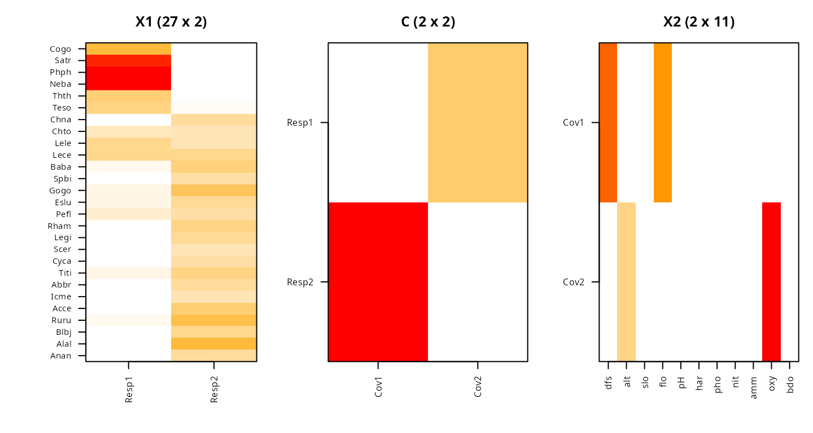
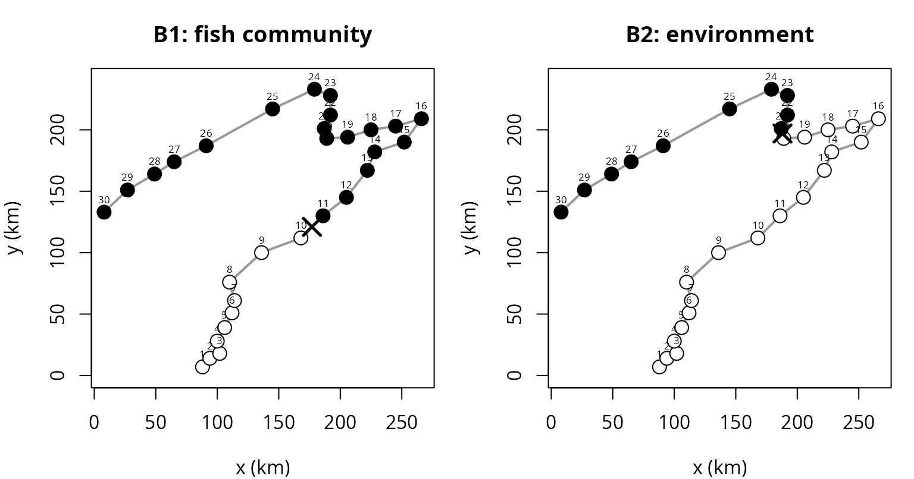

# Co-clustering two variable blocks with NMF-RRR (nmf.rrr)

## Introduction

Many studies measure **two blocks of variables on the same individuals**
– a block of *covariates* (inputs) and a block of *responses* (outputs)
– and ask how *groups* of covariates relate to *groups* of responses.
[`nmf.rrr()`](https://ksatohds.github.io/nmfkc/reference/nmf.rrr.md)
answers this by starting from the multivariate linear regression of the
responses on the covariates and giving its non-negative regression
coefficient matrix a **tri-factorization**

where (each column summing to one) softly clusters the **response
variables**, (each row summing to one) softly clusters the **covariate
variables**, and is a tested matrix of **block correspondences**.
Because has rank , this is the non-negative, parts-based member of the
reduced-rank regression (RRR) family – hence *NMF-RRR* – related to RRR
as NMF is to PCA.

[`nmf.rrr()`](https://ksatohds.github.io/nmfkc/reference/nmf.rrr.md) and
its `nmf.rrr.*` helpers are the interface; the names emphasise the
reduced-rank-regression reading. The former `nmfae()` family names were
deprecated in 0.8.8 and removed in 0.9.8.

This vignette reproduces the **Doubs** example (community ecology),
where a single dominant upstream–downstream gradient aligns both blocks,
so the correspondence is a clean *permutation*.

``` r
library(nmfkc)
```

## The Doubs data

The Doubs data (Verneaux, 1973) record `27` fish species and `11`
environmental variables at `30` sites along a French river – a classic
illustration of canonical (correspondence) analysis. We take the fish
abundances as the **response** block and the environmental variables as
the **covariate** block .

Each variable is mapped to by a per-variable min–max transform
([`nmfkc.normalize()`](https://ksatohds.github.io/nmfkc/reference/nmfkc.normalize.md)),
which makes the sign-free environmental variables non-negative, and both
blocks are laid out as *variables* *sites* ().

``` r
data(doubs, package = "ade4")

# per-variable min-max to [0,1], then transpose to (variables x sites)
nz <- function(M) t(nmfkc.normalize(as.matrix(M)))
Y1 <- nz(doubs$fish)   # responses: 27 fish species x 30 sites
Y2 <- nz(doubs$env)    # covariates: 11 environment x 30 sites
dim(Y1)
#> [1] 27 30
dim(Y2)
#> [1] 11 30
```

## Fitting NMF-RRR

Element-wise cross-validation (below) selects . Signed models and
inference benefit from several k-means restarts, so we set `nstart = 20`
and a tight tolerance.

``` r
fit <- nmf.rrr(Y1, Y2, rank1 = 2, rank2 = 2,
               epsilon = 1e-8, nstart = 20, seed = 1)

# in-sample, column-centered R^2
Y1hat <- fit$X1 %*% fit$C %*% fit$X2 %*% Y2
R2 <- 1 - sum((Y1 - Y1hat)^2) / sum((Y1 - rowMeans(Y1))^2)
round(R2, 3)
#> [1] 0.435
```

The fit is `R2 = 0.435`, reproducing the classical longitudinal zonation
of the river.

### Response groups (fish guilds)

Each column of is a probability vector over the fish species; the top
species per column name the guild.

``` r
for (q in 1:ncol(fit$X1))
  cat(sprintf("Resp%d: %s\n", q,
      paste(rownames(Y1)[order(-fit$X1[, q])[1:6]], collapse = ", ")))
#> Resp1: Neba, Phph, Satr, Cogo, Thth, Teso
#> Resp2: Alal, Ruru, Gogo, Acce, Baba, Titi
```

`Resp1` is a **cold-water upstream guild** (brown trout *Satr*, *Phph*,
*Neba*, *Cogo*, grayling *Thth*) and `Resp2` a **warm-water downstream
guild** (roach *Ruru*, *Gogo*, barbel *Baba*, *Alal*).

### Covariate groups (environmental gradients)

Each row of is a probability vector over the environmental variables.

``` r
for (r in 1:nrow(fit$X2))
  cat(sprintf("Cov%d: %s\n", r,
      paste(rownames(Y2)[order(-fit$X2[r, ])[1:5]], collapse = ", ")))
#> Cov1: dfs, flo, har, nit, pH
#> Cov2: oxy, alt, pH, slo, har
```

`Cov1` is a **nutrient / downstream gradient** (distance from source
`dfs`, flow `flo`, nitrate `nit`, BOD `bdo`) and `Cov2` an **oxic /
upstream gradient** (dissolved oxygen `oxy`, altitude `alt`, pH, slope
`slo`).

## Choosing the two ranks

Because the attainable fit is bounded by , the *in-sample* fit cannot
choose the ranks; we use **element-wise cross-validation**
([`nmf.rrr.ecv()`](https://ksatohds.github.io/nmfkc/reference/nmf.rrr.ecv.md)),
which holds out entries of and predicts them.

``` r
ecv <- nmf.rrr.ecv(Y1, Y2, rank1 = 1:2, rank2 = 1:2,
                   nfolds = 5, seed = 123)
#> Element-wise CV: 4 (Q,R) pairs, 5-fold, 20 tasks...
#>   Q=1, R=1: MSE=0.090948, sigma=0.3016
#>   Q=2, R=1: MSE=0.090948, sigma=0.3016
#>   Q=1, R=2: MSE=0.090954, sigma=0.3016
#>   Q=2, R=2: MSE=0.065768, sigma=0.2565
round(ecv$sigma, 4)
#> Q=1,R=1 Q=2,R=1 Q=1,R=2 Q=2,R=2 
#>  0.3016  0.3016  0.3016  0.2565
```

The smallest hold-out error is at .

## Inference for the correspondence matrix

The entries of say how strongly each covariate group drives each
response group.
[`nmf.rrr.inference()`](https://ksatohds.github.io/nmfkc/reference/nmf.rrr.inference.md)
attaches standard errors (Fisher + wild bootstrap) and a **one-sided
boundary test** (each ).

``` r
inf <- nmf.rrr.inference(fit, Y1, Y2)
co  <- inf$coefficients
print(format(co[order(co$p_value), c("Basis","Covariate","Estimate","SE","z_value","p_value")],
             digits = 3))
#>   Basis Covariate Estimate    SE  z_value  p_value
#> 3 Resp1      Cov2 3.97e+00 0.505 7.86e+00 1.93e-15
#> 2 Resp2      Cov1 1.40e+01 1.837 7.65e+00 1.03e-14
#> 1 Resp1      Cov1 2.06e-48 0.603 3.42e-48 5.00e-01
#> 4 Resp2      Cov2 9.54e-27 1.004 9.51e-27 5.00e-01
```

is a **near-permutation**: the upstream guild is driven by the oxic
gradient and the downstream guild by the nutrient gradient (both ),
while the two off-diagonal paths are essentially zero ().

``` r
round(fit$C, 3)
#>         Cov1  Cov2
#> Resp1  0.000 3.971
#> Resp2 14.049 0.000
```

## Visualising and the two co-clusterings

[`nmf.rrr.heatmap()`](https://ksatohds.github.io/nmfkc/reference/nmf.rrr.heatmap.md)
shows the response basis , the correspondence , and the covariate basis
together.

``` r
nmf.rrr.heatmap(fit)
```



## Clustering the individuals as well as the variables

The same fit clusters the **sites**. The two score matrices

give each site a profile over the covariate groups and over the response
groups; column-normalising them yields soft memberships (`B2.prob`,
`B1.prob`), and the arg-max gives hard labels (`B2.cluster`,
`B1.cluster`). So a single model produces four groupings: two of
variables (, ) and two of individuals (, ).

``` r
max(abs(fit$B1 - fit$C %*% fit$X2 %*% Y2))   # B1 = Theta B2, to machine precision
#> [1] 0
```

The Doubs sites are numbered from the source (1) downstream to (30),
**and that order is never given to the model**. A labelling that comes
out contiguous along the river is therefore a genuine recovery of the
longitudinal gradient, not something the fit was told.

``` r
runs <- function(cl, tag) {
  cl <- as.vector(cl); r <- rle(cl)
  cat(sprintf("%-4s %s\n", tag, paste(cl, collapse = " ")))
  cat(sprintf("%-4s %d run(s): %s\n", "", length(r$lengths),
              paste(sprintf("%s x%d", r$values, r$lengths), collapse = " | ")))
  if (length(r$lengths) == 2)
    cat(sprintf("%-4s one break, between site %d and %d\n", "",
                r$lengths[1], r$lengths[1] + 1))
  cat("\n")
}
runs(fit$B1.cluster, "B1")   # response side: fish community
#> B1   1 1 1 1 1 1 1 1 1 1 2 2 2 2 2 2 2 2 2 2 2 2 2 2 2 2 2 2 2 2
#>      2 run(s): 1 x10 | 2 x20
#>      one break, between site 10 and 11
runs(fit$B2.cluster, "B2")   # covariate side: environment
#> B2   2 2 2 2 2 2 2 2 2 2 2 2 2 2 2 2 2 2 2 2 1 1 1 1 1 1 1 1 1 1
#>      2 run(s): 2 x20 | 1 x10
#>      one break, between site 20 and 21
```

Each side splits the river once, but **not at the same place**: the fish
community changes at site 10\|11, the environment at 20\|21. Sites 11–20
are already downstream-type in their fauna while their measured
environment is still upstream-type – the fish respond before the
environmental variables recorded here cross over.

The soft memberships show how sharp each transition is.

``` r
round(fit$B1.prob[, 8:13], 2)    # response side, around the 10|11 break
#>          8    9   10   11   12   13
#> Resp1 0.66 0.53 0.52 0.45 0.46 0.45
#> Resp2 0.34 0.47 0.48 0.55 0.54 0.55
round(fit$B2.prob[, 18:23], 2)   # covariate side, around the 20|21 break
#>        18  19   20   21   22   23
#> Cov1 0.39 0.4 0.43 0.51 0.52 0.71
#> Cov2 0.61 0.6 0.57 0.49 0.48 0.29
```

### Mapping the clusters onto the river

`doubs$xy` holds schematic map coordinates for the 30 sites, so the two
labellings can be drawn on the river itself.

``` r
xy <- doubs$xy
panel <- function(cl, upstream.level, main, brk) {
  fill <- ifelse(as.vector(cl) == upstream.level, "white", "black")
  plot(xy, type = "n", asp = 1, xlab = "x (km)", ylab = "y (km)", main = main)
  lines(xy, col = "grey60", lwd = 2)                    # river course
  points(xy, pch = 21, bg = fill, col = "black", cex = 1.6)
  text(xy, labels = 1:30, pos = 3, offset = 0.4, cex = 0.55)
  mid <- (xy[brk, ] + xy[brk + 1, ]) / 2                # mark the break
  points(mid, pch = 4, cex = 2, lwd = 2.5)
}
op <- par(mfrow = c(1, 2), mar = c(4, 4, 3, 1))
panel(fit$B1.cluster, 1, "B1: fish community", 10)
panel(fit$B2.cluster, 2, "B2: environment", 20)
```



``` r
par(op)
```

Open circles are the upstream type, filled the downstream type, and the
cross marks the break. Both transitions are single and contiguous, and
the offset between them is the stretch where the two blocks disagree.

Whether supervision matters here is worth checking: `k-means` on either
raw block, blind to the other block, is the natural baseline. Cluster
labels are arbitrary, so agreement is measured in a
label-switch-invariant way.

``` r
set.seed(1)
km1 <- kmeans(t(Y1), 2, nstart = 50)$cluster
km2 <- kmeans(t(Y2), 2, nstart = 50)$cluster
agree <- function(a, b) max(mean(a == b), mean(a != b))
c(B1.vs.kmY1 = agree(km1, as.vector(fit$B1.cluster)),
  B2.vs.kmY2 = agree(km2, as.vector(fit$B2.cluster)))
#> B1.vs.kmY1 B2.vs.kmY2 
#>  0.6000000  0.8666667
runs(km1, "km1")   # k-means on the fish block alone
#> km1  2 2 2 2 2 2 2 2 2 2 2 2 2 2 2 2 2 2 2 1 1 1 2 2 2 1 1 1 1 1
#>      4 run(s): 2 x19 | 1 x3 | 2 x3 | 1 x5
runs(km2, "km2")   # k-means on the environment block alone
#> km2  1 1 1 1 1 1 1 1 1 1 1 1 1 1 1 1 2 2 2 2 2 2 2 2 2 2 2 2 2 2
#>      2 run(s): 1 x16 | 2 x14
#>      one break, between site 16 and 17
```

The covariate side is close (`0.87`): the environmental gradient is
strong enough that an unsupervised split of nearly reproduces . The
response side is not (`0.60`). Left to itself, `k-means` on the fish
block does not even return a contiguous stretch of river – it breaks
late and then scatters a few sites back – because unsupervised
clustering weights whatever variance dominates , gradient or not.

is contiguous because it is not computed from at all: it is , the
environment read through the correspondence matrix. That is what
supervision buys here, and it is also why the two site clusterings can
be compared at all – they are tied to each other through , so the 10\|11
versus 20\|21 offset means something. The same model says which fish
guild goes with which environmental gradient, and where along the river
each one turns over.

## Relation to other methods

Dropping non-negativity, at rank is ordinary **reduced-rank regression**
(RRR): it attains a higher in-sample fit ( on Doubs) but returns
*signed* loadings and no clusters. On these data the two share the
dominant fitted direction (leading principal-angle cosine ); they differ
in the *basis* of that subspace – non-negative parts versus signed
singular directions – exactly as NMF relates to PCA. An unsupervised
**tri-NMF** of the association recovers the *same* guilds and gradients
here (the gradient is so dominant that supervised and unsupervised
co-clusterings coincide), but, unlike NMF-RRR, cannot predict the
community at a new site through .

When within-block and cross-block structure disagree – e.g. under – the
non-negative, normalized parameterization of NMF-RRR stays well-behaved
and exposes *cross-structure* (one response group driven by several
covariate groups) that these baselines miss; see the paper for the
nutrimouse and microbiome–metabolome examples.

## References

- Satoh, K. & Tokuda, Y. Co-clustering of Response and Covariate
  Variables by Tri-Factorizing Their Non-negative Regression Coefficient
  Matrix (manuscript).
- Ding, C., Li, T., Peng, W. & Park, H. (2006). Orthogonal nonnegative
  matrix tri-factorizations for clustering. *KDD*.
- Verneaux, J. (1973). *Cours d’eau de Franche-Comté*. PhD thesis.
  (Doubs data, R package `ade4`.) \`\`\`
