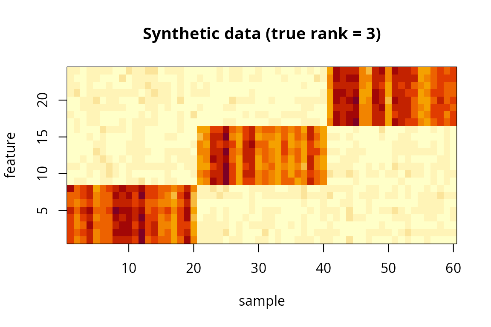
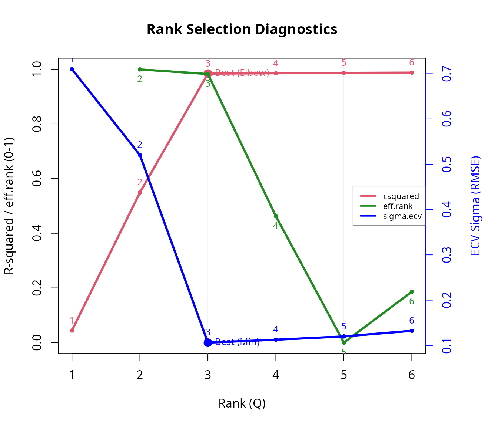
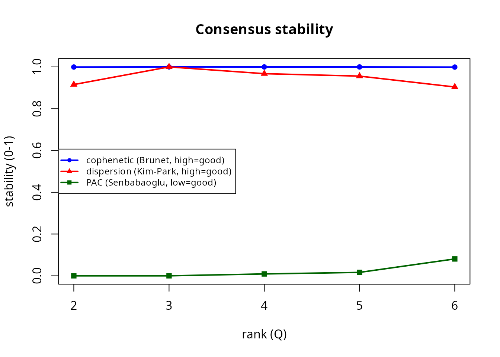
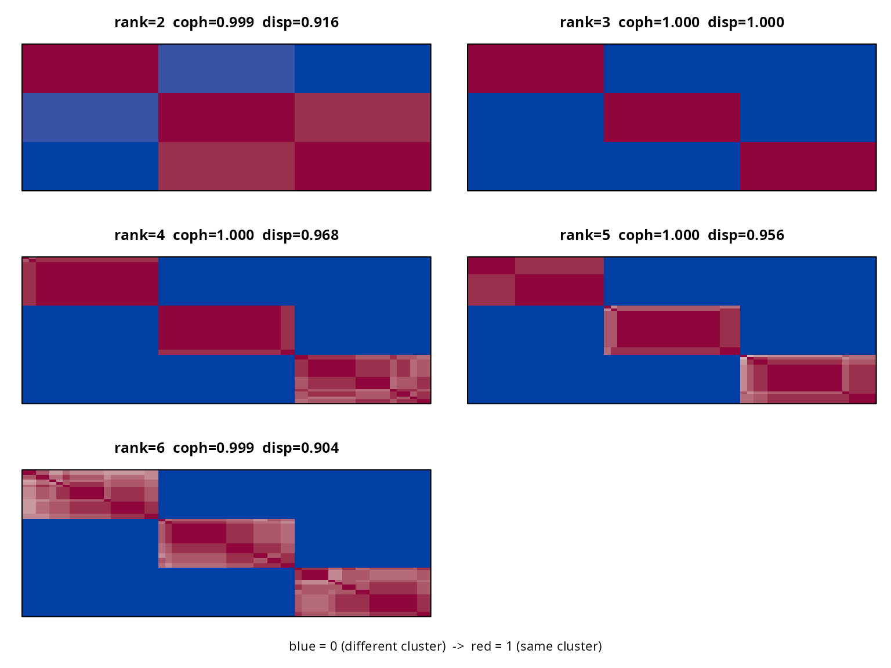
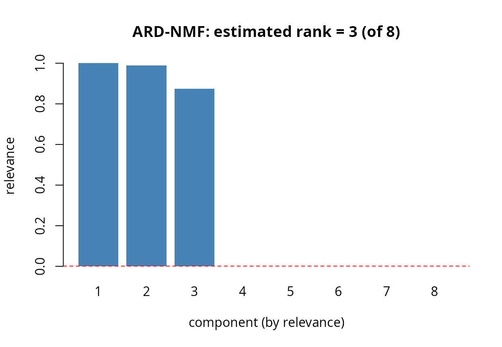
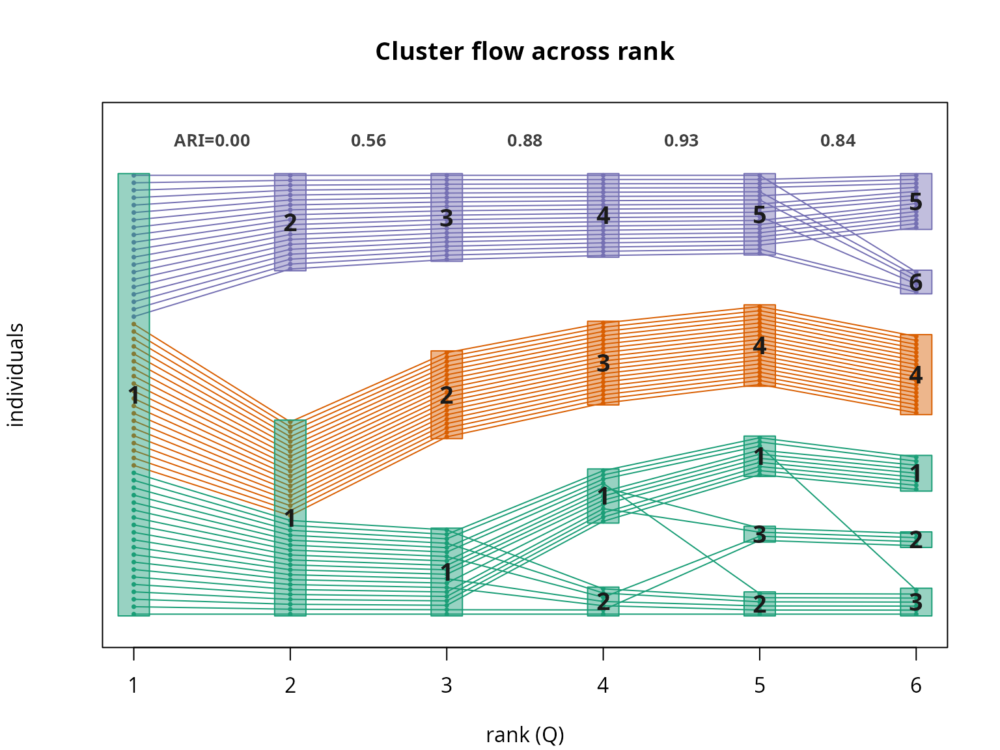

# Choosing the NMF rank on data with a known true rank

## Introduction

Choosing the number of basis vectors (the *rank* `Q`) is the central
tuning problem in NMF. `nmfkc` offers several rank-selection tools, each
based on a different principle:

| function | principle | a good rank… |
|----|----|----|
| `nmfkc.rank` | integrated diagnostics: R-squared, effective rank, element-wise CV | minimises CV error / R-squared elbow |
| `nmfkc.ecv` | element-wise cross-validation (Wold) | minimises held-out error |
| `nmfkc.bicv` | block bi-cross-validation (Owen & Perry) | minimises held-out error |
| `nmfkc.consensus` | clustering stability (Brunet) | maximises stability (or minimises PAC) |
| `nmfkc.ard` | Bayesian automatic relevance determination (Tan & Fevotte) | surviving components after pruning |

Since there is no single “best” criterion, this vignette applies all of
them to a **synthetic dataset whose true rank is known**, so we can see
which ones recover it.

``` r
library(nmfkc)
```

## A synthetic dataset (true rank = 3)

We build a non-negative `24 x 60` matrix from **three** feature blocks
and **three** sample clusters (20 samples each), then add noise. By
construction the true rank is `3`.

``` r
set.seed(123)
r_true <- 3
P <- 24                       # features
n_each <- 20                  # samples per cluster
N <- r_true * n_each          # 60 samples

# basis: each latent factor is a distinct block of features
X <- matrix(0, P, r_true)
X[1:8, 1] <- 1; X[9:16, 2] <- 1; X[17:24, 3] <- 1
X <- X + matrix(runif(P * r_true, 0, 0.1), P, r_true)   # small background

# coefficients: each sample loads mainly on its own cluster's factor
cl_true <- rep(1:r_true, each = n_each)
B <- matrix(runif(r_true * N, 0, 0.2), r_true, N)
for (j in seq_len(N)) B[cl_true[j], j] <- runif(1, 1, 2)

Y <- X %*% B
Y <- Y + matrix(rnorm(P * N, 0, 0.15 * mean(X %*% B)), P, N)  # noise
Y[Y < 0] <- 0

dim(Y)
#> [1] 24 60
image(1:N, 1:P, t(Y), xlab = "sample", ylab = "feature",
      main = "Synthetic data (true rank = 3)")
```



## 1. Integrated diagnostics: `nmfkc.rank`

[`nmfkc.rank()`](https://ksatohds.github.io/nmfkc/reference/nmfkc.rank.md)
fits each rank and draws three curves on one plot: **R-squared** (red,
with a “Best (Elbow)” marker), the broken-stick-corrected **effective
rank** index (green, shown for context), and the element-wise **ECV
error** (blue, with a “Best (Min)” marker). The recommended rank is the
ECV minimum (or the R-squared elbow).

``` r
rk <- nmfkc.rank(Y, rank = 1:6)
#> Y(24,60)~X(24,1)B(1,60)...0sec
#> Y(24,60)~X(24,2)B(2,60)...0sec
#> Y(24,60)~X(24,3)B(3,60)...0sec
#> Y(24,60)~X(24,4)B(4,60)...0sec
#> Y(24,60)~X(24,5)B(5,60)...0sec
#> Y(24,60)~X(24,6)B(6,60)...0sec
#> Running Element-wise CV (this may take time)...
#> Performing Element-wise CV for Q = 1,2,3,4,5,6 (5-fold)...
#> Note: sample-clustering quality (silhouette / CPCC / dist.cor) is not part of rank selection; compute it from a list of fits with nmf.cluster.criteria().  See ?nmf.cluster.criteria
```



``` r
rk$rank.best                       # recommended rank (ECV minimum)
#> [1] 3
round(rk$criteria, 3)
#>   rank effective.rank effective.rank.ratio r.squared sigma.ecv
#> 1    1             NA                   NA     0.044     0.710
#> 2    2          2.000                1.000     0.549     0.520
#> 3    3          2.988                0.996     0.984     0.106
#> 4    4          3.438                0.860     0.985     0.113
#> 5    5          3.440                0.688     0.986     0.120
#> 6    6          4.587                0.764     0.987     0.132
#>   effective.rank.expected effective.rank.index
#> 1                   1.000                   NA
#> 2                   1.649                0.999
#> 3                   2.301                0.982
#> 4                   2.955                0.462
#> 5                   3.609                0.000
#> 6                   4.263                0.186
```

## 2. Cross-validation: `nmfkc.ecv` and `nmfkc.bicv`

Both are predictive engines that return the held-out error per rank; the
recommended rank minimises it. `nmfkc.ecv` holds out scattered *entries*
(Wold’s CV); `nmfkc.bicv` holds out a *block* of rows and columns at
once (Owen & Perry).

``` r
ev <- nmfkc.ecv (Y, rank = 1:6)
#> Performing Element-wise CV for Q = 1,2,3,4,5,6 (5-fold)...
bv <- nmfkc.bicv(Y, rank = 1:6)   # nfolds = 2 (Owen & Perry) by default
#> bi-CV: ranks 1,2,3,4,5,6, 2x2 fold grid (Owen-Perry 2009)...
data.frame(rank = 1:6,
           sigma.ecv  = round(ev$sigma, 3),
           sigma.bicv = round(bv$sigma, 3))
#>     rank sigma.ecv sigma.bicv
#> Q=1    1     0.710      0.725
#> Q=2    2     0.520      0.531
#> Q=3    3     0.106      0.110
#> Q=4    4     0.113      0.111
#> Q=5    5     0.120      0.111
#> Q=6    6     0.132      0.111
cat("ECV  picks rank", which.min(ev$sigma),
    "| bi-CV picks rank", bv$rank[which.min(bv$sigma)], "\n")
#> ECV  picks rank 3 | bi-CV picks rank 3
```

## 3. Clustering stability: `nmfkc.consensus`

For each rank, NMF is run many times from random initialisations and the
reproducibility of the sample clustering is summarised by `cophenetic`
(Brunet), `dispersion` (Kim & Park; higher = crisper) and `pac`
(Senbabaoglu; lower = less ambiguous).

``` r
cs <- nmfkc.consensus(Y, rank = 2:6, nrun = 20, keep.consensus = TRUE)
#> consensus: ranks 2,3,4,5,6, 20 runs/rank (Brunet 2004); 100 fits total...
cs
#> Consensus rank selection (Brunet 2004), 20 runs/rank
#>   best: dispersion max = rank 3 | PAC min = rank 2
#>  rank cophenetic dispersion   pac
#>     2      0.999      0.916 0.000
#>     3      1.000      1.000 0.000
#>     4      1.000      0.968 0.009
#>     5      1.000      0.956 0.016
#>     6      0.999      0.904 0.081
plot(cs)                               # stability curves
```



Each panel is the consensus matrix at one rank, reordered by
hierarchical clustering (blue = 0 / different cluster, red = 1 / same
cluster):

``` r
plot(cs, type = "heatmap")   # all ranks
```



A striking point: the consensus stays essentially **three crisp blocks
even at ranks 4–6**. The surplus basis vectors do **not** create new
*reproducible* clusters — at ranks 4–5 they stay near-empty (the hard
clustering still uses only three factors), and at rank 6 a cluster
splits only *erratically* across restarts, which averages out (just a
few intermediate, pink entries, and a small drop in `dispersion` / rise
in `PAC`). So consensus reveals the genuine stable structure (`3`)
robustly, **even when the rank is over-specified** — a useful property.
(Use `plot(cs, type = "heatmap", rank = 3)` to enlarge a single rank
with sample labels.)

## 4. Bayesian ARD: `nmfkc.ard`

ARD fits NMF **once** at an over-complete rank and prunes unneeded
components automatically; the relevance bar plot is read like a scree
plot (look for the knee). Because it is a sensitive point estimate, we
aggregate over several random restarts (`nrun`).

``` r
ar <- nmfkc.ard(Y, rank = 8, nrun = 20)   # >=10-20 restarts for a stable mode
ar                                        # see "rank over runs" for confidence
#> ARD-NMF rank determination (Tan-Fevotte 2013, L2 prior, 20 runs)
#>   starting rank: 8  ->  estimated rank (mode): 3
#>   rank over runs: 3:20 (median 3)
#>   relevance (representative run): 1 0.989 0.875 0 0 0 0 0
plot(ar)
```



## Summary: did they recover the true rank?

``` r
data.frame(
  method = c("nmfkc.rank (ECV)", "nmfkc.ecv", "nmfkc.bicv",
             "nmfkc.consensus (dispersion)", "nmfkc.consensus (PAC)",
             "nmfkc.ard"),
  estimate = c(rk$rank.best,
               which.min(ev$sigma),
               bv$rank[which.min(bv$sigma)],
               cs$rank[which.max(cs$dispersion)],
               cs$rank[which.min(cs$pac)],
               ar$rank),
  true = r_true
)
#>                         method estimate true
#> 1             nmfkc.rank (ECV)        3    3
#> 2                    nmfkc.ecv        3    3
#> 3                   nmfkc.bicv        3    3
#> 4 nmfkc.consensus (dispersion)        3    3
#> 5        nmfkc.consensus (PAC)        2    3
#> 6                    nmfkc.ard        3    3
```

## How the clustering evolves with rank

A complementary view:
[`nmf.cluster.flow()`](https://ksatohds.github.io/nmfkc/reference/nmf.cluster.flow.md)
draws a Sankey / alluvial diagram of how the hard sample clustering
changes as the rank grows. We fit ranks `1:6` (so the list index equals
the rank) and colour the flows by the clustering at the **true rank**,
`reference = 3`. The adjacent-rank ARI (agreement) is printed along the
top.

``` r
fits <- lapply(1:6, function(q) nmfkc(Y, Q = q, print.dims = FALSE))
fl <- nmf.cluster.flow(fits, reference = 3)
```



``` r
head(fl$clusters)      # rows = individuals, columns = rank, entries = cluster id
#>    1 2 3 4 5 6
#> i1 1 1 1 2 2 3
#> i2 1 1 1 2 3 2
#> i3 1 1 1 1 1 1
#> i4 1 1 1 1 1 1
#> i5 1 1 1 1 1 1
#> i6 1 1 1 1 3 2
```

At `rank = 1` all 60 samples form a single group; at `rank = 3` they
split cleanly into the three true clusters (20 each); beyond that the
groups over-split (the ARI to the next rank starts to fall) — visual
confirmation that `3` is the right number of basis vectors here.

## Remarks

On this clean dataset with a clear rank-3 structure, **almost every
criterion recovers the true rank**: the predictive cross-validations
(`nmfkc.ecv`, `nmfkc.bicv`), the integrated `nmfkc.rank`, the consensus
`dispersion` (with a crisp three-block consensus matrix) and ARD (every
`nrun` restart agrees on `3`, relevance dropping to zero after the third
component) all give `3`. Only `PAC` leans to the coarser rank `2` — a
small hint of the low-rank bias of stability measures.

On **real** data the criteria often *disagree* much more:
stability/consensus tends to favour low (coarse) ranks, and ARD’s count
can track the starting rank when the energy spectrum decays smoothly (no
clear knee). A robust practical recipe is to **triangulate**: use ECV
for the predictive upper bound, the effective-rank / relevance *knee*
for the lower bound, and the consensus heatmap to confirm an
interpretable block structure — then choose one rank by purpose and
domain knowledge.

See
[`?nmfkc.rank`](https://ksatohds.github.io/nmfkc/reference/nmfkc.rank.md),
[`?nmfkc.ecv`](https://ksatohds.github.io/nmfkc/reference/nmfkc.ecv.md),
[`?nmfkc.bicv`](https://ksatohds.github.io/nmfkc/reference/nmfkc.bicv.md),
[`?nmfkc.consensus`](https://ksatohds.github.io/nmfkc/reference/nmfkc.consensus.md)
and
[`?nmfkc.ard`](https://ksatohds.github.io/nmfkc/reference/nmfkc.ard.md)
(all cross-referenced) for details.
