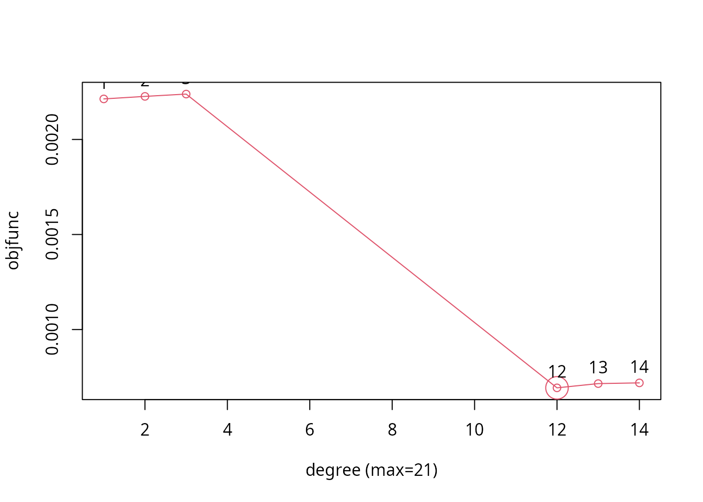
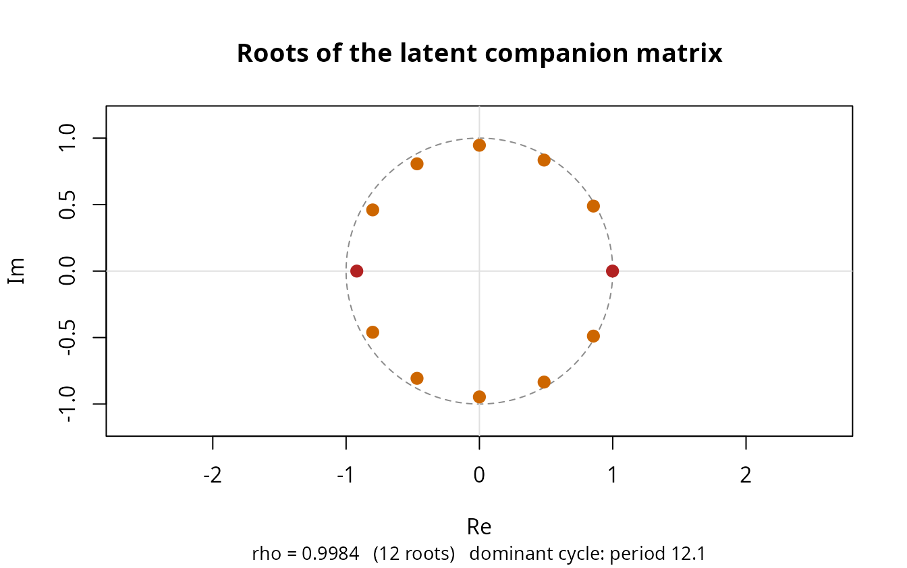
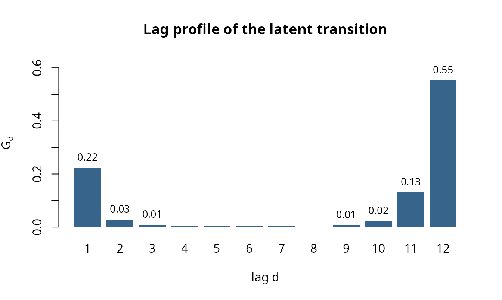
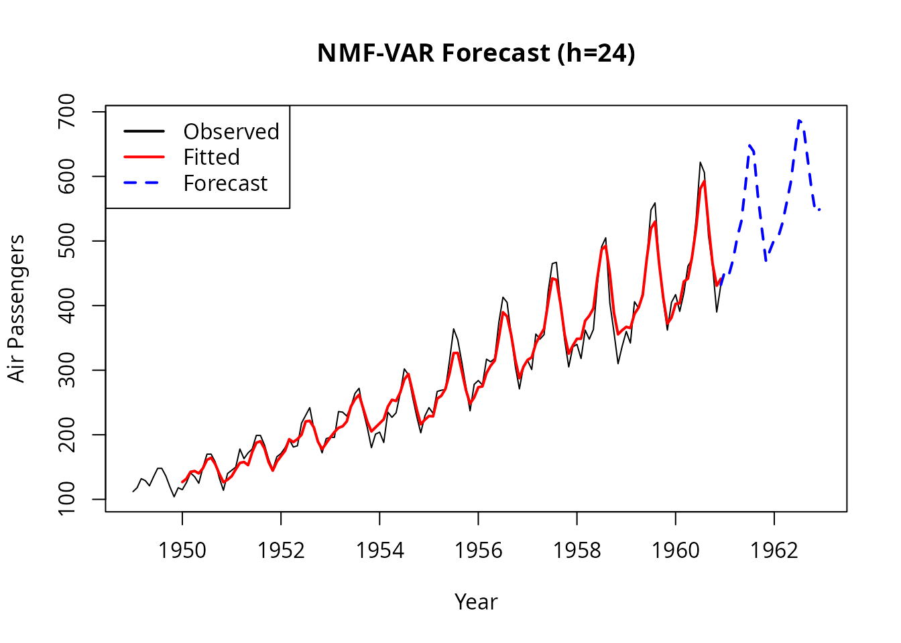
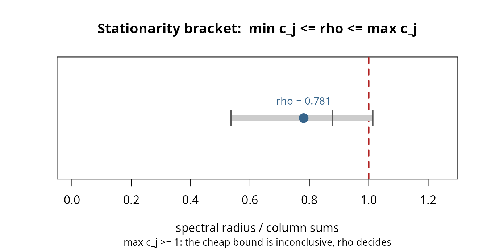
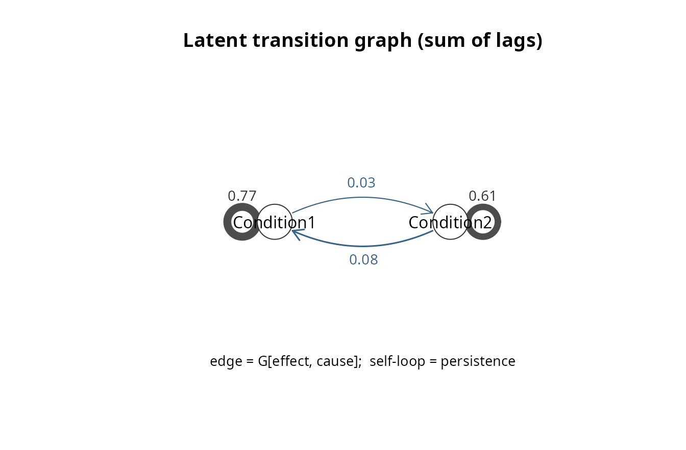
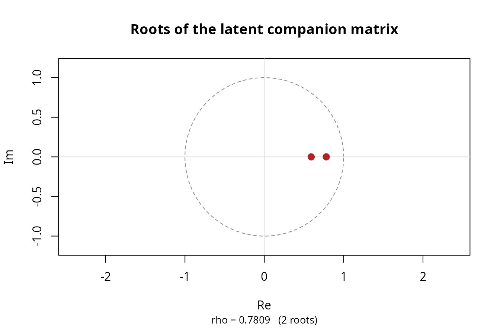
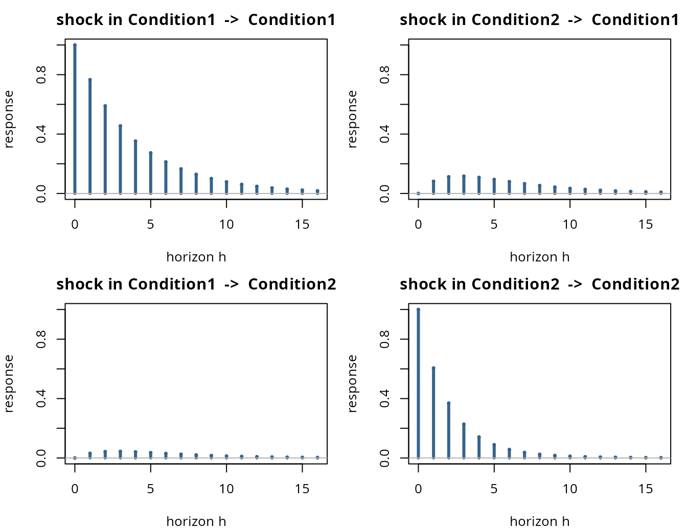
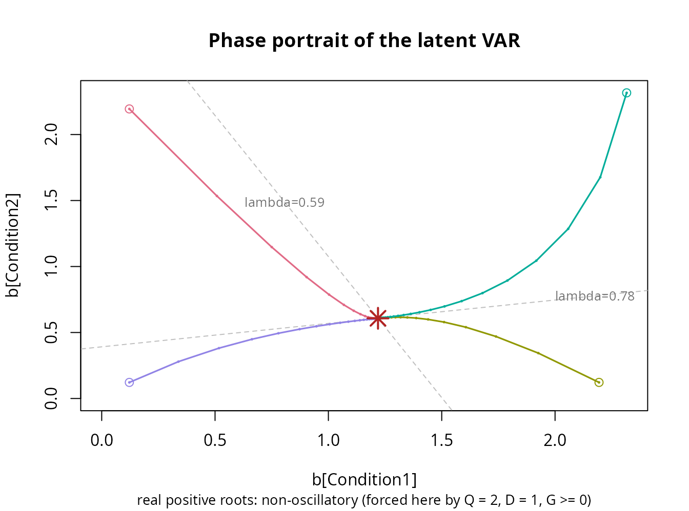
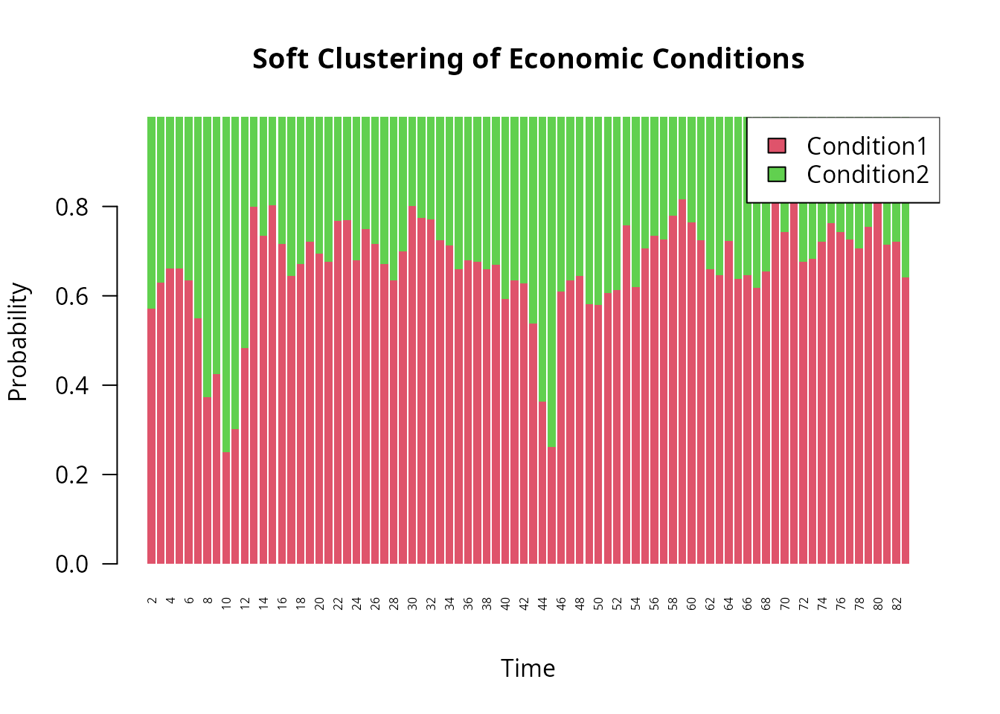

# Time Series Analysis with NMF-VAR

## Introduction

This vignette demonstrates how to apply the `nmfkc` package to time
series data using the **NMF-VAR (Non-negative Matrix Factorization -
Vector Autoregression)** framework. This approach models the coefficient
matrix of NMF as a VAR process (\\B \approx C A\_{lag}\\), allowing for
both dimensionality reduction and temporal modeling.

Key functions in `nmfkc` such as `nmfkc.ar` and `nmfkc.ar.degree.cv`
directly support R’s native **`ts` objects**, preserving time series
properties automatically. Once a model is fitted,
[`nmfkc.ar.stationarity()`](https://ksatohds.github.io/nmfkc/reference/nmfkc.ar.stationarity.md)
checks dynamic stability,
[`nmfkc.ar.latent()`](https://ksatohds.github.io/nmfkc/reference/nmfkc.ar.latent.md)
returns the \\Q \times Q\\ **latent transition matrices** \\G_d =
\Theta_d X\\ — which summarise the dynamics in the low-dimensional
latent space rather than in the \\P \times P\\ observed space, and can
be plotted directly — and
[`nmfkc.ar.latent.inference()`](https://ksatohds.github.io/nmfkc/reference/nmfkc.ar.latent.inference.md)
attaches standard errors to them.

We will cover two scenarios:

1.  **Univariate AR:** Forecasting airline passengers (`AirPassengers`).
2.  **Multivariate VAR:** Analyzing macroeconomic indicators (`Canada`).

First, let’s load the necessary packages.

``` r
library(nmfkc)
library(vars) # For Canada dataset
#> Loading required package: MASS
#> Loading required package: strucchange
#> Loading required package: zoo
#> 
#> Attaching package: 'zoo'
#> The following objects are masked from 'package:base':
#> 
#>     as.Date, as.Date.numeric
#> Loading required package: sandwich
#> Loading required package: urca
#> Loading required package: lmtest
```

------------------------------------------------------------------------

## Example 1: Univariate Autoregression with AirPassengers

The `AirPassengers` dataset contains monthly international airline
passenger numbers. We will model this univariate time series using an
autoregressive (AR) model.

### 1. Data Preparation

We simply log-transform the `ts` object to stabilize variance. We do
**not** need to manually convert it to a matrix or create time vectors;
`nmfkc` functions handle `ts` objects directly.

``` r
# Load and transform the ts object
d_air <- AirPassengers
d_air_log <- log10(d_air) # Still a ts object
```

### 2. Model Selection (Lag Order)

We use **Cross-Validation** to find the optimal degree (lag order). By
passing the `ts` object `d_air_log`, the function automatically handles
the time dimension.

``` r
# Candidate lag orders: short lags plus the seasonal ones (a full 1:14 sweep
# gives the same winner; the subset keeps the vignette quick to build)
# Note: ts objects are automatically transposed to (Variables x Time) internally
cv_res <- nmfkc.ar.degree.cv(d_air_log, rank = 1, degree = c(1:3, 12:14), epsilon=1e-6, maxit=500000)
#> degree=1...0.2sec
#> degree=2...0.6sec
#> degree=3...0.6sec
#> degree=12...0.7sec
#> degree=13...0.8sec
#> degree=14...0.8sec
```



``` r

# Check the optimal degree
cv_res$degree
#> [1] 12

# For this example, we will proceed with D=12 (capturing monthly seasonality)
D <- 12
```

### 3. Model Fitting

We construct the observation matrix `Y` and covariate matrix `A` (lagged
Y) using
[`nmfkc.ar()`](https://ksatohds.github.io/nmfkc/reference/nmfkc.ar.md).
The returned matrices `Y` and `A` will have time-based column names
derived from the `ts` object.

``` r
# Create matrices for the AR(12) model
a_air <- nmfkc.ar(d_air_log, degree = D, intercept = TRUE)

# Fit the NMF-AR model (Rank=1 for univariate)
res_air <- nmfkc(Y = a_air$Y, A = a_air$A, rank = 1, epsilon = 1e-6, maxit=500000)
#> Y(1,132)~X(1,1)C(1,13)A(13,132)=XB(1,132)...0.2sec

# Check goodness of fit
res_air$r.squared
#> [1] 0.9798257

# Check for stationarity (spectral radius < 1)
st_air <- nmfkc.ar.stationarity(res_air)
c(rho = st_air$spectral.radius, stationary = st_air$stationary)
#>        rho stationary 
#>  0.9983758  1.0000000
```

With `rank = 1` the latent VAR is one-dimensional, so the latent view is
at its simplest: the twelve \\1\times1\\ matrices \\G_d\\ are just the
AR coefficients of the single latent series, and `colsum.max` alone
certifies stationarity.

``` r
lat_air <- nmfkc.ar.latent(res_air)
c(rho = lat_air$spectral.radius, colsum.max = lat_air$colsum.max)
#>        rho colsum.max 
#>  0.9983758  0.9856695
unlist(lat_air$G)[1:3]   # G_1, G_2, G_3 of the latent series
#>        lag1        lag2        lag3 
#> 0.222304511 0.028654098 0.008072265
```

\\\rho = 0.999\\ is only just below 1, and the roots say why. All twelve
sit close to the unit circle at roughly equal angles: this is a seasonal
root, not a slow cycle. A single number cannot distinguish the two.

``` r
plot(lat_air, type = "roots")
```



The lag profile shows the same structure in the coefficients themselves
— month 12 dominates, month 1 carries the short-run inertia.

``` r
plot(lat_air, type = "lag")
```



### 4. Forecasting

We can forecast future values using the fitted model. `nmfkc.ar.predict`
uses the time properties stored in the model to generate the correct
future time sequence.

``` r
# Forecast next 2 years (24 months)
h <- 24
pred_res <- nmfkc.ar.predict(x = res_air, Y = a_air$Y, n.ahead = h)

# Convert predictions back to original scale
pred_val <- 10^as.vector(pred_res$pred)
pred_time <- pred_res$time # Future time points generated by the function

# --- Plotting ---
# Setup plot range
xlim_range <- range(c(time(d_air), pred_time))
ylim_range <- range(c(d_air, pred_val))

# 1. Observed data (Black)
plot(d_air, type = "l", col = "black", 
     xlim = xlim_range, ylim = ylim_range, lwd = 1,
     xlab = "Year", ylab = "Air Passengers", main = "NMF-VAR Forecast (h=24)")

# 2. Fitted values during training (Red)
# a_air$Y has column names as time strings; we parse them for plotting
fitted_time <- as.numeric(colnames(res_air$XB))
lines(fitted_time, 10^as.vector(res_air$XB), col = "red", lwd = 2)

# 3. Forecast (Blue)
# Connect the last observed point to the first forecast for a continuous line
last_t <- tail(as.numeric(time(d_air)), 1)
last_y <- tail(as.vector(d_air), 1)
lines(c(last_t, pred_time), c(last_y, pred_val), col = "blue", lwd = 2, lty = 2)

# Add legend
legend("topleft", legend = c("Observed", "Fitted", "Forecast"),
       col = c("black", "red", "blue"), lty = c(1, 1, 2), lwd = 2)
```



------------------------------------------------------------------------

## Example 2: Vector Autoregression with Canada Dataset

The `Canada` dataset contains four quarterly macroeconomic variables.
We’ll use a multivariate NMF-VAR model to analyze the relationship
between these variables.

### 1. Data Preparation

We take the first difference to achieve stationarity, normalize the data
to \\\[0, 1\]\\, and transpose it to the `Variables x Time` format
required by NMF.

``` r
# Load, difference, and normalize
d0_canada <- Canada
dd_canada <- apply(d0_canada, 2, diff) # Returns a matrix (Time x Vars)
dn_canada <- nmfkc.normalize(dd_canada)

# Transpose to (Variables x Time) for NMF
Y0_canada <- t(dn_canada)

# Create matrices for VAR(1)
a_canada <- nmfkc.ar(Y0_canada, degree = 1, intercept = TRUE)
```

### 2. Model Fitting

We fit a model with `rank = 2` to identify two latent economic
conditions driving the four variables.

``` r
# Fit the NMF-VAR model
# epsilon = 1e-8: this fit feeds the inference in Section 5, where coefficients
# sitting on the non-negativity boundary must actually have reached it.
res_canada <- nmfkc(Y = a_canada$Y, A = a_canada$A, rank = 2, prefix = "Condition", epsilon = 1e-8)
#> Y(4,82)~X(4,2)C(2,5)A(5,82)=XB(2,82)...0sec

# R-squared and Stationarity
res_canada$r.squared
#> [1] 0.5994866
st_canada <- nmfkc.ar.stationarity(res_canada)
st_canada
#> rho(companion, 2x2, method="latent") = 0.7809  ->  stationary
#> rho(sum_d G_d)        = 0.7809   (< 1 iff stationary)
#> bracket: min_j c_j = 0.5360  <=  rho(sum_d G_d)  <=  max_j c_j = 1.0150
#>    max_j c_j >= 1: the cheap bound is inconclusive, rho decides
#> 
#> For the dynamics behind this number see nmfkc.ar.latent(), for a test of H0: rho >= 1 see nmfkc.ar.latent.inference().
```

The bracket says the cheap sufficient condition is inconclusive here, so
the eigenvalue is what decides.

``` r
plot(st_canada)
```



### 3. Latent Transition Matrices

The fitted VAR acts on the four observed variables through the \\P
\times P\\ matrices \\\Xi_d = X\Theta_d\\. Those are awkward to read,
and they grow with the number of series. But the same dynamics can be
written in the latent space: the residual-free recursion for the
**coefficient** vector is

\\\boldsymbol b_t=\sum\_{d=1}^{D}G_d\\\boldsymbol
b\_{t-d}+\boldsymbol\theta, \qquad G_d=\Theta_d X\\ \\ (Q\times Q).\\

One caveat before reading anything into the \\G_d\\. This display drops
the observation residual. With \\\boldsymbol y_t = X\boldsymbol
b_t+\boldsymbol e_t\\ the exact identity is

\\\boldsymbol b_t=\sum\_{d}G_d\\\boldsymbol b\_{t-d}+\boldsymbol\theta
+\sum\_{d}\Theta_d\\\boldsymbol e\_{t-d},\\

a VARMA\\(D,D)\\, not a VAR\\(D)\\. So \\G_d\\ is the **autoregressive
operator of the fitted VAR reduced to the latent space** — which is what
every panel below uses — and not the coefficient matrix of a latent VAR
that the scores obey exactly. In particular an entry of \\G_d\\ is not a
Granger-causality statement between latent conditions: the
moving-average term is common to all coordinates and is not conditioned
on.

[`nmfkc.ar.latent()`](https://ksatohds.github.io/nmfkc/reference/nmfkc.ar.latent.md)
returns these **latent transition matrices**. Here that means a single
\\2\times2\\ matrix instead of a \\4\times4\\ one — and for a larger
problem (say 47 regions with 7 lags) it is \\4\times4\\ blocks instead
of \\47\times47\\ ones, which is the difference between something you
can read and something you cannot.

``` r
lat_canada <- nmfkc.ar.latent(res_canada)
lat_canada
#> Latent transition matrices  G_d = Theta_d %*% X   (row = effect at t, column = cause at t-d)
#> 
#> lag1:
#>            Condition1 Condition2
#> Condition1      0.766      0.082
#> Condition2      0.031      0.606
#> 
#> roots: 2 (companion 2x2)   rho = 0.7809  ->  stationary
#> all roots real and positive: non-oscillatory (overshoot is still possible)
#>   (note: with Q = 2, D = 1 and G >= 0 the roots are real by construction --
#>    the absence of a cycle is not a finding)
#> 
#> Long-run mean of the latent scores (mu.b):
#> Condition1 Condition2 
#>      1.219      0.608 
#> Long-run composition (p*):
#> Condition1 Condition2 
#>      0.667      0.333 
#> 
#> Effective dimension df = Q(P + PD + 1 - Q) = 14
#> For the stationarity verdict see nmfkc.ar.stationarity(), for standard errors nmfkc.ar.latent.inference().
```

The convention is **row = effect at \\t\\, column = cause at \\t-d\\**:
entry \\(q,q')\\ says how strongly condition \\q'\\ in the previous
quarter feeds condition \\q\\ now. Diagonal entries are persistence,
off-diagonal entries are spillover between the latent conditions.

``` r
# Persistence of each condition, and cross-condition spillover
diag(lat_canada$G$lag1)
#> Condition1 Condition2 
#>  0.7663220  0.6057199
lat_canada$G$lag1[1, 2]   # effect of Condition2 (t-1) on Condition1 (t)
#> [1] 0.08193278
```

[`nmfkc.ar.stationarity()`](https://ksatohds.github.io/nmfkc/reference/nmfkc.ar.stationarity.md)
above reported three stability numbers that say the same thing in
increasing order of sharpness:

- `colsum.max` — \\\max_j c_j\\ of \\\sum_d \Theta_d\\. If it is below 1
  the model is stationary, with no eigenvalue computation at all. It is
  only a sufficient condition, so a value above 1 (as here) is simply
  inconclusive.
- `spectral.radius.sum` — \\\rho(\sum_d G_d)\\, which is below 1 exactly
  when the model is stationary.
- `spectral.radius` — the spectral radius of the companion matrix
  itself.

The last one can be computed by either of two routes, selected with
`method`. The default `"latent"` uses the \\DQ \times DQ\\ companion
matrix of the \\G_d\\; `"companion"` uses the \\PD \times PD\\ companion
matrix of the \\\Xi_d\\, as earlier versions of the package always did.
The two companion matrices share their non-zero eigenvalues, so the
answers agree — but the latent route is a \\2\times2\\ eigenproblem here
instead of \\4\times4\\, and would be \\28\times28\\ instead of
\\329\times329\\ for a 47-variable, 7-lag, rank-4 model.

``` r
c(latent    = lat_canada$spectral.radius,
  companion = nmfkc.ar.stationarity(res_canada, method = "companion")$spectral.radius)
#>    latent companion 
#> 0.7808507 0.7808507
```

When the fit is stationary the process has a well-defined long-run mean,
which is reported in both the latent and the observed space
(\\\boldsymbol\mu_b\\ and \\\boldsymbol\mu_y = X\boldsymbol\mu_b\\):

``` r
lat_canada$mu.b
#> Condition1 Condition2 
#>  1.2188754  0.6076773
lat_canada$mu.y
#>         e      prod        rw         U 
#> 0.6648544 0.5764437 0.3167251 0.2685294
```

Two further quantities are useful when choosing the rank. `df` is the
*effective* dimension \\Q(P+PD+1-Q)\\ — the right degrees of freedom
when comparing \\R^2\\ or information criteria across \\Q\\, since the
naive count \\Q(P+PD+1)\\ ignores the \\Q^2\\ rotational indeterminacy.
`separability` is a one-line identifiability check: values near 1 mean
each basis owns an essentially pure variable, so the factorization is
unique up to permutation.

``` r
lat_canada$df
#> [1] 14
lat_canada$separability
#> Condition1 Condition2 
#>  0.9999984  1.0000000
```

### 4. Plotting the Latent Dynamics

Section 3 read the \\G_d\\ as numbers.
[`plot()`](https://rdrr.io/r/base/plot.html) draws them. The point of
every panel below is that it stays readable at a size the observed space
does not: this fit has \\Q^2 = 4\\ latent impulse responses instead of
\\P^2 = 16\\, and a 47-region, 7-lag, rank-4 fit would have 16 instead
of 2209.

The **transition graph** shows the feedback structure. Self-loops are
persistence, arrows are spillover; a \\\boldsymbol y\to\boldsymbol b\to
\boldsymbol y\\ bipartite picture splits each round trip in half and so
cannot show that the loop is asymmetric.

``` r
plot(lat_canada, type = "graph")
```



The **roots on the unit circle** say *why* \\\rho\\ is where it is.
Because the \\PD\times PD\\ companion matrix has at most \\DQ\\ non-zero
eigenvalues, all of them fit on one plot. Complex roots are drawn
separately and their period is reported — a fit can sit near the
boundary because it cycles or because it is seasonal, and a single
number cannot tell those apart.

``` r
plot(lat_canada, type = "roots")
```



The **impulse responses** are non-negative for every horizon, since
\\G_d\ge0\\. The shape is therefore a decay (own effect) or a hump
(cross effect, zero at \\h = 0\\), and the half-life can be read
straight off.

``` r
plot(lat_canada, type = "irf")
```



The **phase portrait** shows the pull towards \\\boldsymbol\mu_b\\. Both
eigenvalues here are real and positive (0.781 and 0.591), so
trajectories decay into the fixed point rather than spiralling:
`lat_canada$non.oscillatory` is `TRUE`.

Three things must be said about that, because the panel invites three
overclaims. First, at \\Q = 2\\, \\D = 1\\ with \\G\ge0\\ the roots
**cannot** be complex — the discriminant is \\(a-d)^2+4bc\ge0\\ — so the
absence of a cycle here is a property of the design, not a finding about
Canada. A cycle needs \\Q\ge3\\ or \\D\ge2\\. Second, non-oscillatory is
*not* the same as monotone: a non-normal \\G\\ can send a coordinate up
before it comes down, which is exactly what the off-diagonal impulse
responses above do (they peak at \\h=3\\). The flag is named after the
roots for that reason. Third, the two decay rates are close (ratio
\\0.591/0.781=0.76\\), so there is no sharp “collapse fast, then slide
slow” separation: after eight quarters 43% of an initial deviation still
sits in the fast direction.

What the panel does say is where the pull points and along which
combinations. Thanks to non-negativity the slow eigenvector has both
components positive — a common level of the two conditions, weighted
0.85 : 0.15 towards Condition 1 — while the fast one has opposite signs,
i.e. an imbalance between them. The imbalance corrects relative to the
level with a half-life of about 2.5 quarters.

``` r
plot(lat_canada, type = "phase")
```



One more panel is available: `type = "lag"` plots \\(G_d)\_{qq'}\\
against \\d\\ — with \\D = 1\\ there is nothing to see, but for a
multi-lag fit it answers “how many periods does a shock take to arrive”,
inside the model rather than from cross-correlations computed outside
it. (The stationarity bracket is drawn by
[`plot()`](https://rdrr.io/r/base/plot.html) on the
`nmfkc.ar.stationarity` object, as in Section 2.)

### 5. Standard Errors for the Latent VAR

Every number in Sections 3 and 4 is a point estimate from 82 quarters.
[`nmfkc.ar.latent.inference()`](https://ksatohds.github.io/nmfkc/reference/nmfkc.ar.latent.inference.md)
attaches a wild bootstrap to all of them: it resamples the residuals,
re-fits the whole NMF-VAR on each replicate, and recomputes the latent
quantities.

``` r
inf_canada <- nmfkc.ar.latent.inference(lat_canada, a_canada$Y, a_canada$A,
                                        wild.B = 50, wild.seed = 2026)
inf_canada
#> Bootstrap inference for the latent VAR
#>   B = 50 (0 failed), unit = "column", dist = "rademacher", truncation rate = 1.24%
#> 
#> Latent transition matrices  G_d = Theta_d %*% X   (row = effect at t, column = cause at t-d)
#>   Identified: unique up to a permutation of the bases; the zeros it rests on hold to 1.6e-06, so an equivalent fit mixes the bases by at most about 0.00016%.
#> 
#> lag1:
#>            Condition1 Condition2
#> Condition1      0.766      0.082
#> Condition2      0.031      0.606
#> SE:
#>            Condition1 Condition2
#> Condition1      0.104      0.059
#> Condition2      0.068      0.094
#> p-value:
#>            Condition1 Condition2
#> Condition1       0.00       0.48
#> Condition2       0.76       0.00
#> 
#> rho(G) = 0.7809   SE = 0.0949   95% CI = [0.6752, 0.9970]
#>   bootstrap mean = 0.8491  (bias +0.0683)
#>   bootstrap tail P*(rho* >= 1) = 0.020
#>   (a tail probability around the fitted model, NOT a unit-root test: the
#>    replicates are not drawn under an imposed H0: rho = 1)
#> 
#> complex eigenvalues: point estimate no, in 0.0% of replicates
#> 
#> long-run composition p*:
#>            estimate  lower  upper
#> Condition1   0.6673 0.5405 0.7095
#> Condition2   0.3327 0.2905 0.4595
#> 
#> strict complementarity: 4 boundary coords, all multipliers positive = TRUE, ratio = 112.5
```

**What is identified decides what can be bootstrapped.** The
factorization is unique only up to \\(X,\Theta)\to(XT,T^{-1}\Theta)\\,
so an individual entry of \\\Theta\\ means nothing across replicates —
replicate 7’s “Condition 1” need not be the original’s. Under that same
map \\G_d \to T^{-1}G_dT\\, so the *spectrum* is untouched: \\\rho\\,
the eigenvalues and \\\boldsymbol\mu_y\\ are invariant outright and need
no alignment at all.

The entries of \\G_d\\ and the composition \\\boldsymbol p^\ast\\ are a
different matter: they would need \\T\\ to be a permutation, and for
\\Q\ge2\\ that cannot be certified. Column normalization removes only
the *scale* part of \\T\\, and a separable basis — each condition owning
a variable that loads on it alone, which this fit does have —

``` r
round(lat_canada$X / rowSums(lat_canada$X), 3)   # rows normalized to sum 1
#>      Condition1 Condition2
#> e         1.000      0.000
#> prod      0.722      0.278
#> rw        0.125      0.875
#> U         0.000      1.000
lat_canada$separability
#> Condition1 Condition2 
#>  0.9999984  1.0000000
```

is not enough either. The uniqueness theorem assumes the *population*
basis is separable and then singles out the separable representative; it
does not say the estimator lands on it, because the objective is flat
along the family. A two-line counterexample makes the point:

``` r
X <- diag(2); Theta <- matrix(c(2, 1, 3, 1), 2, 2)   # X is perfectly separable
T <- matrix(c(.9, .1, .1, .9), 2, 2)                 # and column-normalized
c(XT.nonneg = all(X %*% T >= 0), colsums = all(colSums(X %*% T) == 1),
  TinvTheta.nonneg = all(solve(T) %*% Theta >= 0),
  same.product = all.equal(X %*% Theta, (X %*% T) %*% (solve(T) %*% Theta)))
#>        XT.nonneg          colsums TinvTheta.nonneg     same.product 
#>             TRUE             TRUE             TRUE             TRUE
rbind(G = as.numeric(Theta %*% X),                       # the two representatives
      G.alt = as.numeric((solve(T) %*% Theta) %*% (X %*% T)))
#>         [,1]   [,2]   [,3]   [,4]
#> G     2.0000 1.0000 3.0000 1.0000
#> G.alt 2.2375 0.8625 3.1375 0.7625
```

Both factorizations are admissible, \\T\\ is no permutation, and \\G\\
differs — \\\Theta\\ has no pure column there, which is the side the
counterexample breaks.

What *does* pin \\T\\ down is the pair of one-sided conditions: an
**anchor row** for every column of \\X\\ forces \\T\ge0\\, a **pure
column** for every row of \\\Theta\\ forces \\T^{-1}\ge0\\, and a
non-negative matrix with a non-negative inverse is monomial. This fit
satisfies both — but only to within the thresholds, since multiplicative
updates leak a little rather than producing exact zeros:

``` r
inf_canada$identified.approx
#> [1] TRUE
unlist(inf_canada$identification[c("anchor.margin", "pure.margin")])
#> anchor.margin   pure.margin 
#>  1.584670e-06  9.644653e-07
```

Both margins are around \\10^{-6}\\, i.e. the fit is very close to a
configuration the uniqueness theorem covers, but it does not literally
satisfy its hypotheses. So `identified.approx` is a **diagnostic, not a
certificate**, and the entry-level columns below should be read as
well-behaved rather than certified. \\\rho\\, the eigenvalues and
\\\boldsymbol\mu_y\\ are invariant under the whole family and need none
of this.

``` r
inf_canada$coefficients
#>   Lag      Basis  Covariate   Estimate        BSE       CI_low   CI_high
#> 1   1 Condition1 Condition1 0.76632196 0.10419980 0.6074697968 0.9437548
#> 2   1 Condition2 Condition1 0.03105503 0.06783299 0.0001236741 0.2282448
#> 3   1 Condition1 Condition2 0.08193278 0.05923828 0.0148432334 0.2086580
#> 4   1 Condition2 Condition2 0.60571985 0.09384040 0.5087705690 0.8547712
#>   p_value
#> 1    0.00
#> 2    0.76
#> 3    0.48
#> 4    0.00
```

With that caveat: the diagonal entries have \\p\\-values near 0 while
the off-diagonal ones do not (0.61 and 0.87). Even taken descriptively,
the asymmetric spillover visible in the transition graph is not
supported by 82 quarters of data.

**`prob.nonstationary` is a tail probability, not a unit-root test.** It
reports \\P^\ast(\rho^\ast\ge1)\\ with replicates drawn around the
*estimated* model. Nothing imposes \\H_0:\rho=1\\, so it is not a
p-value for that hypothesis; a proper test would have to resample under
the null.

``` r
c(rho  = inf_canada$spectral.radius,
  se   = inf_canada$spectral.radius.se,
  lo   = inf_canada$spectral.radius.ci.lower,
  hi   = inf_canada$spectral.radius.ci.upper,
  tail = inf_canada$prob.nonstationary)
#>        rho         se         lo         hi       tail 
#> 0.78085067 0.09485203 0.67515748 0.99699597 0.02000000
```

The long-run mean gets an interval too, so the level the process reverts
to can be reported with uncertainty rather than as a bare number:

``` r
rbind(estimate = inf_canada$mu.y,
      lower    = inf_canada$mu.y.ci.lower,
      upper    = inf_canada$mu.y.ci.upper)
#>               [,1]      [,2]      [,3]      [,4]
#> estimate 0.6648544 0.5764437 0.3167251 0.2685294
#> lower    0.4742694 0.4038747 0.2633305 0.2216688
#> upper    1.2653695 1.1707735 0.6983002 0.6437495
```

Two diagnostics deserve a look before the intervals are trusted.

`truncate.rate` is the fraction of replicate observations that fell
below zero and were clipped; a large value means the wild bootstrap is
being distorted by the non-negativity constraint. At 1.2% here it is
not.

`kkt` is the **strict complementarity** diagnostic, and its reading is
less obvious than it looks. The estimated zeros of \\\Theta\\ only
estimate something if two margins stay away from zero:
\\\delta\_\mathrm{dual}\\, the smallest KKT multiplier over the zero
coefficients, and \\\delta\_\mathrm{prim}\\, the smallest surviving
positive coefficient.

``` r
c(truncate.rate = inf_canada$truncate.rate,
  n.boundary    = inf_canada$kkt$n.boundary,
  delta.dual    = inf_canada$kkt$delta.dual,
  delta.prim    = inf_canada$kkt$delta.prim,
  kkt.ratio     = inf_canada$kkt$ratio,
  usable.reps   = inf_canada$wild.B,
  failed.reps   = inf_canada$n.fail)
#> truncate.rate    n.boundary    delta.dual    delta.prim     kkt.ratio 
#>  1.243902e-02  4.000000e+00  2.144266e-03  2.017429e-01  1.124564e+02 
#>   usable.reps   failed.reps 
#>  5.000000e+01  0.000000e+00
```

A **small** dual margin is not a numerical defect — it is a statement
about the model. If the model were correctly specified,
\\\Xi_0=X\Theta\\ would make the population multipliers exactly zero, so
strict complementarity would fail at *every* zero coefficient and
\\P(\hat\theta_k=0)\\ would tend to a constant in \\(0,1)\\ (one half
for an isolated zero) instead of to one. What makes the zeros estimate
anything is **misspecification**: they recover the coordinates whose
*unconstrained* population coefficient is strictly negative. Canada’s
ratio of 112 says those four zeros are well separated, so they are
estimating a sign restriction rather than a degenerate boundary.

Two practical points. The re-fits reproduce the **same estimator** as
the original fit: `method` and `X.restriction` are taken from the fitted
object, a literal `seed` from its recorded call, and with
`X.restriction = "fixed"` the fixed basis itself. Anything else the
original call set (`X.init` under other restrictions, penalties) cannot
be recovered from the fitted object, and the function warns and asks for
it through `refit.args=`.

``` r
unlist(inf_canada$refit.args)
#>        method X.restriction 
#>          "EU"     "colSums"
```

And each replicate is a full re-fit, so this is the expensive step of
the analysis. `wild.B = 50` keeps the vignette quick; the default is
500, and each re-fit converges to `epsilon = 1e-8` — a looser tolerance
leaves boundary coefficients spuriously positive and understates the
spread. On a multi-core machine `cores = 4` divides the wall time
without changing the answer.

### 6. Latent Structure & Causal Graph

We can visualize how the two latent conditions change over time.

``` r
# Visualize soft clustering of time trends
barplot(res_canada$B.prob, col = c(2, 3), border = NA,
        main = "Soft Clustering of Economic Conditions",
        xlab = "Time", ylab = "Probability",
        names.arg = colnames(a_canada$Y), las=2, cex.names = 0.5)
legend("topright", legend = colnames(res_canada$X), fill = c(2, 3), bg = "white")
```



Finally, we can generate a **DOT script** to visualize the Granger
causality (relationships) between variables inferred by the model.

``` r
# Generate DOT script for graph visualization
dot_script <- nmfkc.ar.DOT(res_canada, intercept = TRUE, threshold=0.01)

# plot(dot_script)  # requires DiagrammeR
```
