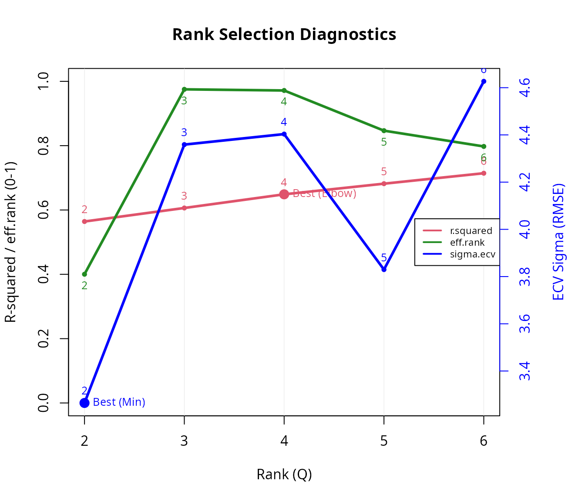
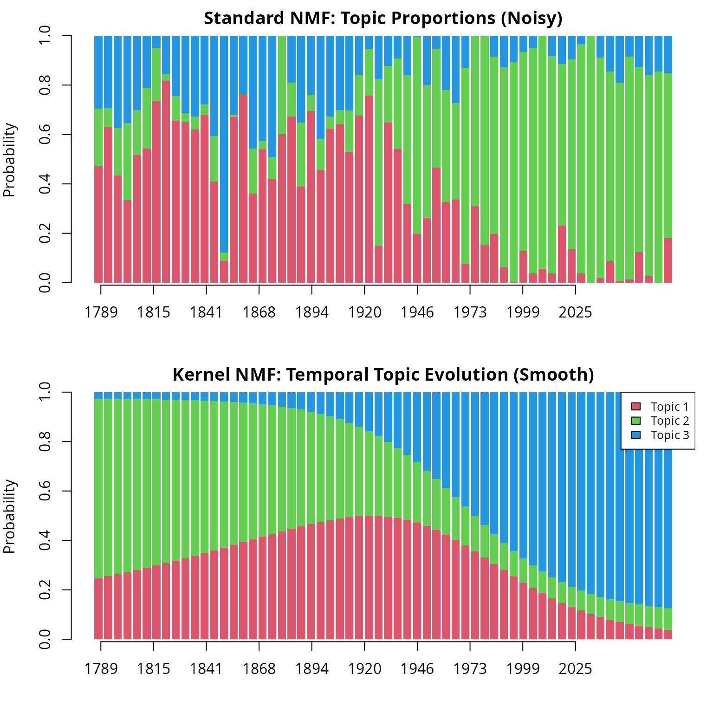

# Topic Modeling with nmfkc

## Introduction

Non-negative Matrix Factorization (NMF) is a powerful technique for
topic modeling. By decomposing a document-term matrix, we can
simultaneously discover latent **Topics** (clusters of words) and their
**Trends** (proportions in documents).

This vignette demonstrates how to use the `nmfkc` package to analyze the
U.S. presidential inaugural addresses using the `quanteda` package.

We will cover:

1.  **Data Preparation**: Converting text data into a matrix format
    suitable for `nmfkc`.
2.  **Rank Selection**: Determining the optimal number of topics using
    robust Cross-Validation.
3.  **Standard NMF**: Extracting basic topics and interpreting key
    words.
4.  **Kernel NMF**: Modeling the **temporal evolution** of topics using
    the “Year” as a covariate.

First, let’s load the necessary packages.

``` r
library(nmfkc)
library(quanteda)
#> Package version: 4.5.0
#> Unicode version: 17.0
#> ICU version: 78.2
#> Parallel computing: disabled
#> See https://quanteda.io for tutorials and examples.
```

## 1. Data Preparation

We create a Document-Feature Matrix (DFM) where rows represent documents
and columns represent words.

``` r
# Load the corpus from quanteda
corp <- corpus(data_corpus_inaugural)

# Preprocessing: tokenize, remove stopwords, and punctuation
tok <- tokens(corp, remove_punct = TRUE)
tok <- tokens_remove(tok, pattern = stopwords("en", source = "snowball"))

# Create DFM and filter
df <- dfm(tok)
df <- dfm_select(df, min_nchar = 3) # Remove short words (<= 2 chars)
df <- dfm_trim(df, min_termfreq = 100) # Remove rare words (appearing < 100 times)

# --- CRITICAL STEP ---
# quanteda's DFM is (Documents x Words).
# nmfkc expects (Words x Documents).
# We must transpose the matrix.
d <- as.matrix(df)
# Sort by frequency
index <- order(colSums(d), decreasing=TRUE) 
d <- d[,index]
Y <- t(d)

dim(Y) # Features (Words) x Samples (Documents)
#> [1] 69 60
```

## 2. Rank Selection (Number of Topics)

Before fitting the model, we need to decide the number of topics
(\\rank\\). The
[`nmfkc.rank()`](https://ksatohds.github.io/nmfkc/reference/nmfkc.rank.md)
function helps us choose an appropriate rank.

The default `detail = "full"` performs **Element-wise Cross-Validation
(Wold’s CV)**. This method randomly holds out individual matrix elements
and evaluates how well the model predicts them, providing a robust
measure for rank selection (though it takes more computation time).

``` r
# Evaluate ranks from 2 to 6
nmfkc.rank(Y, rank = 2:6)
#> Y(69,60)~X(69,2)B(2,60)...0sec
#> Y(69,60)~X(69,3)B(3,60)...0sec
#> Y(69,60)~X(69,4)B(4,60)...0sec
#> Y(69,60)~X(69,5)B(5,60)...0sec
#> Y(69,60)~X(69,6)B(6,60)...0sec
#> Running Element-wise CV (this may take time)...
#> Performing Element-wise CV for Q = 2,3,4,5,6 (5-fold)...
#> Note: sample-clustering quality (silhouette / CPCC / dist.cor) is not part of rank selection; compute it from a list of fits with nmf.cluster.criteria().  See ?nmf.cluster.criteria
```



Looking at the diagnostics (the minimum ECV Sigma and the elbow of the
R-squared curve; the green `eff.rank` line is shown for context), let’s
assume **Rank = 3** is a reasonable choice for this overview.

## 3. Standard NMF

We fit the standard NMF model (\\Y \approx XB\\) with `rank = 3`. In the
context of topic modeling:

- **\\X\\ (Basis Matrix):** Represents **Topics** (distribution of
  words).
- **\\B\\ (Coefficient Matrix):** Represents **Trends** (distribution of
  topics across documents).

``` r
rank <- 3
# Set seed for reproducibility
res_std <- nmfkc(Y, rank = rank, seed = 123, prefix = "Topic")
#> Y(69,60)~X(69,3)B(3,60)...0sec

# Check Goodness of Fit (R-squared)
res_std$r.squared
#> [1] 0.6062205
```

### Interpreting Topics (Keywords)

We can identify the meaning of each topic by looking at the words with
the highest weights in the basis matrix `X`.

``` r
# Extract top 10 words for each topic from X.prob (normalized X)
Xp <- res_std$X.prob
for(q in 1:rank){
  message(paste0("----- Featured words on Topic [", q, "] -----"))
  print(paste0(rownames(Xp), "(", rowSums(Y), ") ", round(100*Xp[,q], 1), "%")[Xp[,q]>=0.5])
}
#> ----- Featured words on Topic [1] -----
#>  [1] "government(575) 53.6%" "states(343) 60.8%"     "shall(316) 61.5%"     
#>  [4] "public(227) 71.5%"     "united(211) 63.9%"     "union(190) 51.8%"     
#>  [7] "war(181) 66.2%"        "national(162) 66.5%"   "law(132) 63.7%"       
#> [10] "just(131) 54.5%"       "congress(130) 62.6%"   "laws(130) 82.9%"      
#> [13] "interests(115) 56.9%"  "foreign(109) 70.4%"    "among(108) 65.8%"     
#> [16] "policy(100) 97.6%"
#> ----- Featured words on Topic [2] -----
#>  [1] "must(377) 59.8%"    "world(329) 96.7%"   "nation(324) 65.8%" 
#>  [4] "peace(259) 56.1%"   "new(256) 90.4%"     "time(223) 55.4%"   
#>  [7] "america(220) 100%"  "nations(199) 55.8%" "freedom(188) 80.1%"
#> [10] "american(185) 62%"  "let(162) 99.7%"     "make(151) 55.9%"   
#> [13] "justice(146) 52%"   "life(141) 73.6%"    "work(125) 90.3%"   
#> [16] "hope(122) 63.3%"    "today(115) 100%"    "know(112) 100%"    
#> [19] "fellow(111) 58.3%"  "history(108) 79.5%"
#> ----- Featured words on Topic [3] -----
#>  [1] "may(343) 57.3%"          "one(274) 57.2%"         
#>  [3] "power(246) 90.5%"        "constitution(210) 89.3%"
#>  [5] "spirit(144) 75.5%"       "never(141) 54.6%"       
#>  [7] "rights(139) 62.6%"       "liberty(123) 70.6%"     
#>  [9] "duty(121) 51%"           "well(120) 62.2%"        
#> [11] "much(114) 51.4%"         "state(112) 76.9%"       
#> [13] "president(104) 54.7%"    "powers(102) 67.5%"
```

*(Note: Interpretation depends on the result. For example, one topic
might contain words like “government, people, states” (Political), while
another might have “world, peace, freedom” (International).)*

## 4. Kernel NMF: Temporal Topic Evolution

One of the unique features of `nmfkc` is **Kernel NMF**. In standard
NMF, the order of documents is ignored; each speech is treated
independently. However, inaugural addresses have a strong **temporal
component**. By using the “Year” as a covariate, we can smooth the topic
proportions over time to see historical shifts.

### Optimizing the Kernel Parameter

We construct a covariate matrix `U` using the year of the address. We
then find the optimal kernel bandwidth (`beta`) using Cross-Validation.

``` r
# Covariate: Year of the address
years <- as.numeric(substring(names(data_corpus_inaugural), 1, 4))
U <- t(as.matrix(years))

# Optimize beta (Gaussian Kernel width)
# We test a specific range of betas to locate the minimum CV error.
beta_candidates <- c(0.2, 0.5, 1, 2, 5) / 10000

# Run CV to find the best beta
# Note: We use the same rank (rank=3) as selected above.
cv_res <- nmfkc.kernel.beta.cv(Y, rank = rank, U = U, beta = beta_candidates, plot = FALSE)
#> beta=2e-05...0sec
#> beta=5e-05...0sec
#> beta=1e-04...0sec
#> beta=2e-04...0sec
#> beta=5e-04...0sec
best_beta <- cv_res$beta
print(best_beta)
#> [1] 2e-04
```

### Fitting Kernel NMF

Now we fit the model using the kernel matrix `A`. This enforces that
documents close in time (similar years) should have similar topic
distributions.

``` r
# Create Kernel Matrix
A <- nmfkc.kernel(U, beta = best_beta)

# Fit NMF with Kernel Covariates
res_ker <- nmfkc(Y, A = A, rank = rank, seed = 123, prefix = "Topic")
#> Y(69,60)~X(69,3)C(3,60)A(60,60)=XB(3,60)...0sec
```

### Visualization: Standard vs Kernel NMF

Let’s compare how topic proportions change over time.

- **Standard NMF (Top):** Shows noisy fluctuations. It captures the
  specific content of each speech but misses the larger historical
  context.
- **Kernel NMF (Bottom):** Reveals smooth historical trends, showing how
  themes like “Nation Building” vs “Global Affairs” have evolved over
  centuries.

``` r
oldpar <- par(mfrow = c(2, 1), mar = c(4, 4, 2, 1))

# Prepare Axis Labels (Rounded to integers)
at_points <- seq(1, ncol(Y), length.out = 10)
labels_years <- round(seq(min(years), max(years), length.out = 10))

# 1. Standard NMF (Noisy)
barplot(res_std$B.prob, col = 2:(rank+1), border = NA, xaxt='n',
        main = "Standard NMF: Topic Proportions (Noisy)", ylab = "Probability")
axis(1, at = at_points, labels = labels_years)

# 2. Kernel NMF (Smooth trend)
barplot(res_ker$B.prob, col = 2:(rank+1), border = NA, xaxt='n',
        main = "Kernel NMF: Temporal Topic Evolution (Smooth)", ylab = "Probability")
axis(1, at = at_points, labels = labels_years)

# Legend
legend("topright", legend = paste("Topic", 1:rank), fill = 2:(rank+1), bg="white", cex=0.8)
```



``` r
par(oldpar)
```
